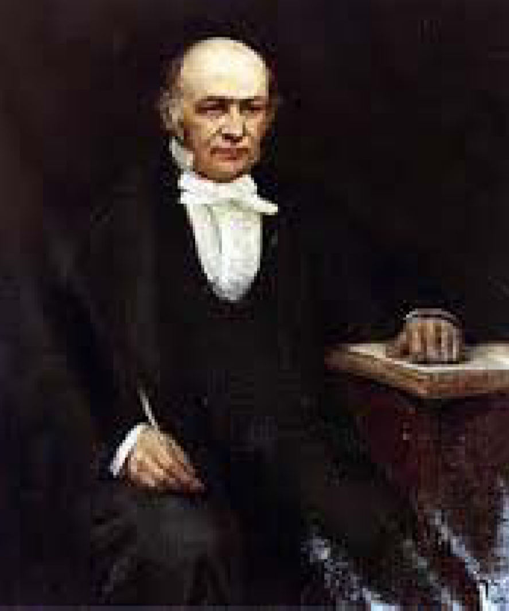
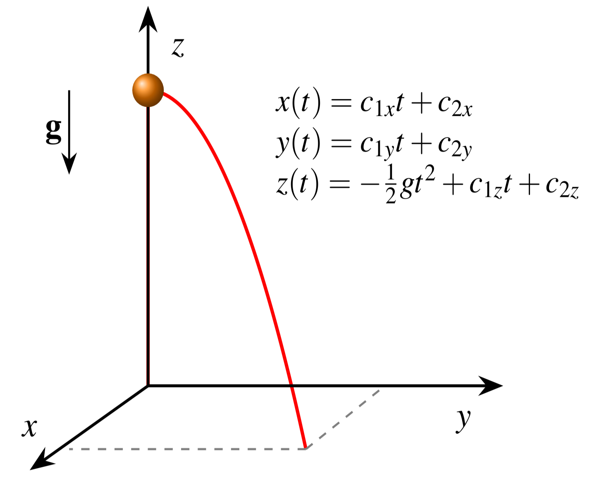

## Progression dans le cours

- Chapitre 0 : Plan de cours  :white_check_mark:
- Chapitre 1 : Rappel  :white_check_mark:
- Chapitre 2 : Formalisme de Lagrange  :white_check_mark:
- Chapitre 3 : Applications et propriétés  :white_check_mark:
- Chapitre 4 : Formalisme canonique  :arrow_left:
- Chapitre 5 : Théorie des perturbations
- Chapitre 6 : Mouvement d'un solide indéformable
- Chapitre 7 : Mécanique lagrangienne des milieux continus
- Chapitre 8 : Annexes

## SOMMAIRE DU CHAPITRE 4

**Formalisme canonique hamiltonien**

4.1 Transformation de Legendre\
4.2 L'hamiltonien\
4.3 Quelques exemples\
4.4 Crochets de Poisson\
4.5 Moments généralisés\
4.6 Transformations canoniques\
4.7 La méthode de Hamilton-Jacobi\
4.8 $T(q_i,p_i)$ en coordonnées généralisées\
4.9 Interprétation de la fonction $S$\
4.10 Mécanique ondulatoire\
4.11 Résumé\

## Introduction {.smaller}

### Le formalisme canonique hamiltonien :

- N'introduit pas une nouvelle physique, mais plutôt une transformation qui prolonge le travail de Lagrange; le principe physique fondamental demeure donc la stationnarité de l'action.
- Introduit une nouvelle gamme d'outils pour étudier les phénomènes physiques.
- A pour élément central l'**hamiltonien** qui joue aussi un grand rôle en mécanique quantique.
- Continue de reposer sur les énergies cinétique et potentielle $T$ et $V$, mais en mettant en évidence **l'énergie totale et les moments conjugués aussi appelés moments généralisés ou moments canoniques.**

:::{.notes}
- Ne pas s'attendre à de grandes simplifications de résolution de problèmes mécaniques! Commence à ouvrir de nouvelles approches de résolution classique plus géométriques qui porteront plus fruit dans de prochains cours, visant à inventer des approches de résolutions à des problèmes qui n'en n'ont pas encore et découvrir de la nouvelle physique qui n'a pas toujours besoin de résolution jusqu'au niveau de trajectoires.
- Espace de phase comme nouvel outil d'intérêt (ToDo: développer plus dans ce chapitre.)
- Voir si j'ajoute ⬆ que les quantités conservées émergent plus naturellement des symétries Noether...
:::

## Contexte historique
::: {layout-ncol=2 style="font-size: 0.8em;"}

### Sir William Rowan Hamilton (1805-1865)
{width="30%" fig-align="left"}

### Contributions
- plusieurs contributions en mécanique dont le formalisme présenté dans ce chapitre ;
- invention des quaternions ;
- loi anticommutative pour les produits vectoriels ;
- contributions multidisciplinaires en optique, dynamique et algèbre.
:::

## Conclusions des formalismes lagrangien et hamiltonien {.center}

Formalisme de Lagrange - un système mécanique à $n$ ddl décrit par les coordonnées généralisées $q_i\mid\; i=1,2,3\dots n$ indépendantes mène à $n$ équations d'E-L, $\frac{d}{dt}\left(\frac{\partial L}{\partial\dot q_i}\right) - \frac{\partial L}{\partial q_i} = 0,$
s'évaluant à **$n$ éq. du mouvement qui sont des EDOs du 2ᵉ ordre**.

:::{.callout-important title="Formalisme canonique de Hamilton"}
Le même système à $n$ ddl, toujours décrit par des $q_i$ indépendantes, mènera plutôt à **$2n$ éq. du mouvement qui sont alors des EDOs du 1ᵉʳ ordre**.
:::

## Lagrange $\to$ Hamilton

**Chez Lagrange** : comparaison d'ensemble de trajectoires avec $q_i$ et les $\dot q_i$ tous indépendants, tant que les équations d'E-L ne sont pas résolues pour obtenir la trajectoire d'action stationnaire.

**Chez Hamilton** : les **moments conjugués** $p_i$, qui sont aussi des **moments généralisés** au même titre que les vitesses généralisées $\dot q_i$ qu'ils remplacent, seront aussi indépendants entre eux et des $q_i$.

$$\text{Lagrange} \; \xrightarrow[\dot q_i \to p_i]{\text{Transf. de Legendre}} \; \text{Hamilton}$$

# 4.1 Transformation de Legendre

## Introduction de la transformation de Legendre

Outil mathématique utilisé en

- **thermodynamique** pour relier les différents potentiels thermodynamiques,
- **mécanique classique** pour définir l'hamiltonien à partir du lagrangien.

[Capsule vidéo de _Abide By Reason_](https://youtu.be/P2HZelQm7Lw?si=VSXDpjAfGCo9XoB6) illustrant la transformation d'une variable indépendante avant de passer au cas multi-variables traité dans cette section.

## La transformation de Legendre

### Description mathématique générale

Soit une fonction $f(u,v)$ où **$u$ et $v$ sont les 2 variables indépendantes** dont dépend $f$. Définissons :

:::{.r-frame}
$$w = \frac{\partial f(u,v)}{\partial v} = w(u,v)$$
:::

La transformation de Legendre (TLegendre) permet de définir une fonction $g(u,w)$ qui **remplace** $f(u,v)$ :

:::{.r-frame}
$$f(u,v) \mapsto g(u,w) = v\cdot w - f$$
:::

## Vérification de la transformation de Legendre {.scrollable}

Est-ce qu'il y a bien changement de variable indépendante en posant la TLegendre $g(u,w) = v\cdot w - f$ ?

Calculons la différentielle totale $df$ et substituons la définition de $w(u,v)$:
$$df(u,v) = \frac{\partial f}{\partial u}du + \frac{\partial f}{\partial v}dv = \frac{\partial f}{\partial u}du + w\,dv$$

De la définition de $g$, calculons sa différentielle totale
\begin{align*}
dg &= w\,dv + v\,dw - df \\
&= w\,dv + v\,dw - \frac{\partial f}{\partial u}du - w\,dv \\
&= v\,dw - \frac{\partial f}{\partial u}du.
\end{align*}

:::{.notes}
- Au tableau ré-écrire g=v*w-f et montre que dg=\del g/\del v dv + del g/\del w dw + del g/\del f df (f est alors comme variable indépendante... ok?)
- TODO: Ajouter un quiz demandant quelle sont les variables indépendantes de $g$ restantes à la fin.
:::

Le terme en $dv$ s'annule en laissant uniquement les différentielles $du$ et $dw$. Ceci confirme que $g$ est bien explicitement fonction des variables indépendentes $u$ et de $w$ seulement. 

Pour opérationnaliser cette transformation en faisant disparaître complètement $v$ de $g$, l'inversion de la définition de $w$, qui était
$$w(u,v) = \frac{\partial f(u,v)}{\partial v},$$

doit exister afin d'isoler $v=v(u,w)$ et le substituer dans
$$g(u,w) = wv(u,w) - f(u,v(u,w)).$$

## Identification des dérivées partielles de $g$ {.scrollable}

Puisque $g$ est fonction de $u$ et $w$,
$$dg = \frac{\partial g}{\partial u}du + \frac{\partial g}{\partial w}dw.$$

En comparant avec l'expression pour $dg$  tout juste obtenue, soit 
$$dg = v\,dw - \frac{\partial f}{\partial u}du,$$

on identifie terme à terme

:::{.center}
::::{.callout-note appearance="minimal" icon=false}
$$v = \frac{\partial g}{\partial w}, \qquad \frac{\partial g}{\partial u} = -\frac{\partial f}{\partial u}$$
::::
:::

La construction mathématique générale de la TLegendre sera directement transposée au couple lagrangien-hamiltonien en débutant la section suivante.

# 4.2 L'hamiltonien $H$

## TLegendre appliquée au lagrangien

La fonction $f(u,v)$ à transformer est maintenant le lagrangien $L(q_i,\dot q_i,t)$, avec les coordonnées $q_i$ jouant le rôle de $u$ et les vitesses $\dot q_i$, celui de $v$. Schématiquement,
\begin{align*}
L(q_i,\dot q_i,t) &\Longleftrightarrow f(u,v)\\
q_i &\Longleftrightarrow u\\
\dot q_i &\Longleftrightarrow v\\
p_i \equiv \left(\frac{\partial L}{\partial\dot q_i}\right) &\Longleftrightarrow w = \left(\frac{\partial f}{\partial v}\right)\\
H(q_i,p_i,t) &\Longleftrightarrow g(u,w)
\end{align*}

:::{.notes}
- ToDo: ajouter t &\Longleftrightarrow t\\ dans la liste quand la mise en forme de diapo sera mieux fixée.
:::

## Moments conjugués/généralisés/canoniques

Notons d'abord que ces 3 adjectifs de moments sont synonymes. Leur définition n'est pas nouvelle, mais elle est recadrée comme analogue de $w(u,v)$. Le système de $n$ équations
$$p_i \equiv \frac{\partial L}{\partial\dot q_i} = p_i(q_j,\dot q_j,t) \quad\text{où } i,j=1,2,3, \dots,n$$

doit cependant pouvoir s'inverser pour obtenir les $n$ relations $\dot q_i = \dot q_i(q_j,p_j,t)$ à substituer pour faire disparaître les vitesses généralisées du lagrangien.

## Définition de l'hamiltonien

Par analogie avec $g(u,w)$, on définit une fonction des $q_i$ et des $p_i$, notée $H(q_i,p_i,t)$ et appelée hamiltonien:

$$
\begin{array}{ccccc}
g(u,w) & = & v \cdot w & - & f \\[0.3em]
\Downarrow & & \Downarrow & & \Downarrow \\[0.3em]
H(q_i,p_i,t) & = & \sum_{i=1}^{n} \dot q_i p_i & - & L(q_i,\dot q_i,t)
\end{array}
$$

où $\dot q_i$ est présumé être $\dot q_i(q_i,p_i,t)$ à substituer. 

## Vérification du changement de variables indépendantes $\dot q_i \to p_i$ entre $L\to H$ {.scrollable}

La différentielle totale du lagrangien
\begin{align*}
dL &= \sum_i\frac{\partial L}{\partial q_i}dq_i + \sum_i\frac{\partial L}{\partial\dot q_i}d\dot q_i + \frac{\partial L}{\partial t}dt\\ 
&= \sum_i\frac{\partial L}{\partial q_i}dq_i + \sum_i p_i\,d\dot q_i + \frac{\partial L}{\partial t}dt
\end{align*}

se substitue dans la différentielle totale de l'hamiltonien obtenu de sa définition $H=\sum_i \dot q_i p_i - L$, soit

\begin{align*}
dH &= d\left(\sum_i \dot q_i p_i\right) - dL\\ 
&= \sum_i \dot q_i\,dp_i + \sum_i p_i\,d\dot q_i - \underbrace{\left[\sum_i\frac{\partial L}{\partial q_i}dq_i + \sum_i p_i\,d\dot q_i + \frac{\partial L}{\partial t}dt\right]}_{dL}
\end{align*}

Les termes $\sum_i p_i\,d\dot q_i$ s'annulent exactement, c'est précisément l'effet recherché de la transformation de Legendre. Les différentielles ordinaires restantes identifient les variables indépendantes dans

$$dH = \sum_i \dot q_i\,dp_i - \sum_i\frac{\partial L}{\partial q_i}dq_i - \frac{\partial L}{\partial t}dt,$$

ce qui vérifie que $H$ est fonction des $q_i$, des $p_i$ et de $t$ seulement.

## Les équations canoniques {.scrollable}
### Identification des dérivées partielles de $H$

Puisque $H=H(q_i,p_i,t)$, sa différentielle totale s'écrit comme à l'habitude
$$dH = \sum_i\frac{\partial H}{\partial q_i}dq_i + \sum_i\frac{\partial H}{\partial p_i}dp_i + \frac{\partial H}{\partial t}dt$$

pour se comparer à l'expression précédente
$$dH = \sum_i \dot q_i\,dp_i - \sum_i\frac{\partial L}{\partial q_i}dq_i - \frac{\partial L}{\partial t}dt.$$

L'indépendance des variables $q_i$, $p_i$ et $t$ permet l'identification terme à terme
\begin{align*}
\frac{\partial H}{\partial q_i} &= -\frac{\partial L}{\partial q_i}; \; n\text{ éqs.}\\
\frac{\partial H}{\partial p_i} &= \dot q_i; \; n\text{ éqs.}\\
\frac{\partial H}{\partial t} &= -\frac{\partial L}{\partial t} 
\end{align*}

La trajectoire physique obéit à aux équations d'E-L, d'où
$$\dfrac{\partial L}{\partial q_i} = \dfrac{d}{dt}\left(\dfrac{\partial L}{\partial\dot q_i}\right) = \dot p_i$$

en permettant la substitution simplificatrice qui donne une écriture plus symétrique de l'identification des dérivées partielles :
\begin{align*}
-\frac{\partial H}{\partial q_i} &= \dot p_i; \; n\text{ éqs.}\\
\frac{\partial H}{\partial p_i} &= \dot q_i; \; n\text{ éqs.}\\
\frac{\partial H}{\partial t} &= -\frac{\partial L}{\partial t} 
\end{align*}

## Les $2n$ équations canoniques {.scrollable}
### En l'absence de dépendance explicite sur le temps
$$\frac{\partial H}{\partial t} = -\frac{\partial L}{\partial t} =0$$

::: {.callout-important title="Définition des équations canoniques"}
$$
\left.
\begin{aligned}
\dot q_i &= \frac{\partial H}{\partial p_i}\\[0.8em]
\dot p_i &= -\frac{\partial H}{\partial q_i}
\end{aligned}
\right\}
\qquad i = 1, 2, \dots, n
$$
:::

$n$ ddl et $n$ équations d'E-L du 2ᵉ ordre $\implies$ $2n$ équations canoniques du 1ᵉʳ ordre.

:::{.notes}
Les $2n$ équations canoniques remplacent les $n$ équations d'E-L.
:::

## Symétrie symplectique

::: {.callout-note title="Définition 4.1 — Symétrie symplectique"}
L'apparition du signe moins entre les équations pour les $q_i$ et celles pour leurs moments conjugués $p_i$ :
$$\dot q_i = +\frac{\partial H}{\partial p_i}, \qquad (q_i \leftrightharpoons p_i, \; \pm \leftrightharpoons \mp) \qquad \dot p_i = -\frac{\partial H}{\partial q_i}$$
correspond à une **symétrie symplectique**.
:::

## Quand $H$ est-il une constante du mouvement ? {.scrollable}

En calculant $dH/dt$ sur une trajectoire qui obéit aux équations canoniques :
\begin{align*}
\frac{dH}{dt} &= \sum_i\frac{\partial H}{\partial q_i}\dot q_i + \sum_i\frac{\partial H}{\partial p_i}\dot p_i + \frac{\partial H}{\partial t}\\
&= \sum_i\left(-\dot p_i\right)\dot q_i + \sum_i\dot q_i\dot p_i + \frac{\partial H}{\partial t} \\
&= \frac{\partial H}{\partial t}\\ 
&= -\frac{\partial L}{\partial t}\\
\end{align*}

::: {.callout-note title="Conditions pour $H=$ cte"}
Si $H$ ne dépend pas explicitement du temps, alors $H$ est une constante du mouvement, aussi dite intégrale première. Physiquement, $H$ constant signifie qu'aucun agent extérieur n'agit sur le système de façon non constante dans le temps.
:::

:::{.notes}
- Dupliquer ou déplacer des notes en fin de Lagrange sur H qui est l'énergie ou pas ici 
- Remarquer en vérifiant que la dérivée ordinaire , pas partiellee est nécessaire à l'intégration pour obtenir H constant dans le temps. Intégration partielle... sur juste un morceau de variation, weird!
:::

## Résumé
\begin{align*}
H &= \sum_i \dot q_i p_i - L \\
\dot q_i &= \frac{\partial H}{\partial p_i}, \; \dot p_i=-\frac{\partial H}{\partial q_i} \\
\frac{dH}{dt} &= \frac{\partial H}{\partial t}=-\frac{\partial L}{\partial t} \\
H &= T+V=\text{énergie si } V\equiv V(q), \\
H &= \text{cte si } \frac{\partial H}{\partial t}=-\frac{\partial L}{\partial t}=0
\end{align*}

# 4.3 Exemples & Espace de phases

## {.scrollable}
::::{.callout-caution title="Cas général d'une particule soumise à une force quelconque en 1D "}

#### Énoncé

Soit une force $F(x)=-\frac{\partial V}{\partial x}$ appliquée sur une particule ponctuelle de masse $m$ en 1D.

#### Analyse du problème 

- **Contraintes :** Aucune.
- **Degré de liberté :** 1 particule dans l'espace 1D $\implies$ 1 ddl.
- **Coordonnée généralisée :** $q_1=x$ selon la direction d'application de la force

#### Mécanique lagrangienne

- **Énergie cinétique :** $\displaystyle T = \frac{m}{2}\dot x^2$.
- **Énergie potentielle :** $V(x)$.
- **Lagrangien :** $L(x,\dot x,t) = \dfrac{m}{2}\dot x^2 - V(x)$.

:::{.notes}
Toujours mettre le lagrangien L au tableau
:::

#### Mécanique hamiltonienne

- Moment $p$ conjugué à $x$ : $p_x = \dfrac{\partial L}{\partial\dot x} = m\dot x$
- Isolement de la vitesse généralisée: $\dot x(p_x) = \dfrac{p_x}{m}$
- Selon la définition de l'hamiltonien :
$$H(x,p_x) = \dot x(p_x)\cdot p_x - L(x,\dot x(p_x))$$

:::{.fragment}
$$H(x,p_x) = \frac{p_x}{m}\cdot p_x - \left[\frac{m}{2}\left(\frac{p_x}{m}\right)^2 + V(x)\right] = \frac{p_x^2}{2m}+V(x)$$
:::

::::

## Que représente $\dfrac{p_x^2}{2m}$ ? {.quiz-question}

- "1)" La quantité de mouvement de la particule
- ["2)" L'énergie cinétique, exprimée avec le moment $p$]{.correct data-explanation="Avec p = mv, on a p²/2m = (mv)²/2m = ½mv². C'est la même énergie cinétique T, écrite en fonction de p plutôt que de v, comme l'exige H(q, p, t)."}
- "3)" L'énergie potentielle de la particule
- '4)' L'énergie mécanique totale.

## Pour $H=\dfrac{p_x^2}{2m}+V(x)$, l'hamiltonien est-il constant au cours du mouvement ? {.quiz-question}

- ["1)" Oui, pour n'importe quel potentiel V(x)]{.correct data-explanation="H ne dépend pas explicitement de t, donc dH/dt = ∂H/∂t = 0. Vérification directe : dH/dt = (p/m)·ṗ + V'(x)·ẋ = (p/m)(−V') + V'(p/m) = 0. Ici H = T + V est l'énergie mécanique, qui se conserve."}
- "2)" Seulement pour la particule libre, V = 0
- "3)" Seulement si V(x) est harmonique, V = kx²/2
- "4)" Non, car x et p varient avec le temps

## {.scrollable}
::::{.callout-caution title="Suite - Cas particulier de la particule libre : $V(x)=0$ "}

#### Énoncé

Soit aucune force appliquée sur une particule ponctuelle de masse $m$ en 1D, d'où l'hamiltonien se réduit à
$$H=\frac{p_x^2}{2m}$$

#### Équations canoniques

\begin{align*}
\dot q_1 &= \frac{\partial H}{\partial p_1}\\
\dot p_1 &= -\frac{\partial H}{\partial q_1}
\end{align*}

_**pour la vitesse généralisée $\dot q_1 = \dot x$**_

$$\dot x = \frac{\partial H}{\partial p_x}$$

:::{.fragment}
\begin{align*}
\dot x &= \frac{p_x}{m} = v\\
p_x &= mv
\end{align*}
:::

:::{.notes}
callout-tip title="Équation du mouvement en $x$" style="text-align: center; font-size: 1.3em;"
$$\dot x = c_{1x}$$
:::

_**pour la dérivée temporelle du moment conjugué $\dot p_1 = \dot p_x$**_

$$\dot p_x &= -\frac{\partial H}{\partial x}$$

:::{.fragment}
$$\dot p_x = 0$$
:::

:::{.notes}
callout-tip title="Équation du mouvement en $y$" style="font-size: 1.3em;"
$$\dot y = c_{1y}$$
:::

#### Résolution de l'EDO du mouvement

Par intégration sur le temps, $p_x = C_1$, soit la quantité de mouvement constante attendue. En substituant, $m\dot x = C_1$ et la trajectoire est bien linéaire
$$x(t) = C_2 t.$$

::::

## L'espace des phases {.smaller}

Une fois les équations canoniques résolues, **l'état** d'un système à un instant $t$ donné, _i.e._ le temps $t$ devient un paramètre, peut être représenté par un point 
$$Z(q_1,\dots,q_n,p_1,\dots,p_n)$$

- dans un espace à **$2n$ dimensions**
- appelé l'**espace des phases**.

Outil omniprésent en physique (physique statistique, mécanique quantique, etc.), associé à tout un ensemble de propriétés formelles des systèmes dynamiques.

::: {.callout-important title="Portrait de phase"}
Un système n'occupe généralement que certaines valeurs des variables canoniques $(q_i,p_i)$. On peut les visualiser sur un **portrait de phase** — un graphique des valeurs possibles de $(q_i,p_i)$.
:::

:::{.notes}
Portrait obtenu en modes XY au lab 6 :) ...figures de lissajous
:::

## Portrait de phase : ex. de la particule libre {.scrollable}

```{python}
from IPython.display import HTML, display
import numpy as np
import plotly.graph_objects as go
import plotly.figure_factory as ff

def show(fig):
    display(HTML(fig.to_html(
        full_html=False,
        include_plotlyjs="cdn",
        include_mathjax=False,
        config={"displayModeBar": False})))

# H = p²/2m (m = 1) :  q' = p,  p' = 0
fig = go.Figure()

# points fixes : toute la droite p = 0
fig.add_trace(go.Scatter(
    x=[-5, 5], y=[0, 0], mode="lines",
    line=dict(color="gray", dash="dash", width=2),
    hovertemplate="p=0 : particule au repos<extra></extra>"))

# trajectoires : droites p = constante
for p0 in [-2, -1.5, -1, -0.5, 0.5, 1, 1.5, 2]:
    fig.add_trace(go.Scatter(
        x=[-5, 5], y=[p0, p0], mode="lines",
        line=dict(color="lightsteelblue", width=1.5),
        hovertemplate=f"p = {p0}<br>H = {p0**2/2:.2f}<extra></extra>"))

# champ de vecteurs (longueur proportionnelle à la vitesse)
qs, ps = np.meshgrid(np.linspace(-4, 4, 9),
                     [-2, -1.5, -1, -0.5, 0.5, 1, 1.5, 2])
quiv = ff.create_quiver(qs.ravel(), ps.ravel(),
                        ps.ravel(), np.zeros(ps.size),
                        scale=0.3, arrow_scale=0.25,
                        line=dict(color="steelblue", width=2))
for tr in quiv.data:
    tr.hoverinfo = "skip"
    fig.add_trace(tr)

fig.add_annotation(x=4.5, y=1.3, text="se déplace vers la droite", showarrow=False)
fig.add_annotation(x=4.5, y=-1.3, text="se déplace vers la gauche", showarrow=False)
fig.add_annotation(x=-4.3, y=0.2, text="au repos", showarrow=False)

fig.update_layout(
    template="simple_white", showlegend=False,
    width=900, height=420, margin=dict(l=60, r=20, t=20, b=50),
    xaxis=dict(title="q", range=[-5, 5]),
    yaxis=dict(title="p", range=[-2.7, 2.7]))
show(fig)
```

- $v = \dot q = p/m$, $\dot p = 0$ : $p$ est **constant**, car $q$ est cyclique.
- Chaque trajectoire définie par des conditions initiales différentes est une droite horizontale $p=p_0$, parcourue à vitesse $p_0/m$.
- L'axe $p=0$ est une ligne de points fixes.


## {.scrollable}
::::{.callout-caution title="Cas particulier de la chute libre verticale : $V(q)=mgq$ "}

#### Énoncé

Soit une balle ponctuelle de masse $m$ lancée verticalement (1D) dans un champ gravitationnel $g$. L'hamiltonien s'écrit alors
$$H=\frac{p^2}{2m}+mgq$$

#### Équations canoniques

\begin{align*}
\dot q &= \frac{\partial H}{\partial p}\\
\dot p &= -\frac{\partial H}{\partial q}
\end{align*}

_**pour la vitesse généralisée $\dot q$**_

$$\dot q = \frac{\partial H}{\partial p}$$

:::{.fragment}
\begin{align*}
\dot q &= \frac{p}{m} = v\\
p &= mv
\end{align*}
:::

:::{.notes}
callout-tip title="Équation du mouvement en $x$" style="text-align: center; font-size: 1.3em;"
$$\dot x = c_{1x}$$
:::

_**pour la dérivée temporelle du moment conjugué $\dot p$**_

$$\dot p &= -\frac{\partial H}{\partial q}$$

:::{.fragment}
$$\dot p = -mg$$
:::

:::{.notes}
callout-tip title="Équation du mouvement en $y$" style="font-size: 1.3em;"
$$\dot y = c_{1y}$$
:::

::::

## Portrait de phase : ex. de la chute verticale {.scrollable}

```{python}
#| echo: false
import numpy as np
import plotly.graph_objects as go
import plotly.figure_factory as ff

# H = p²/2 + g q  (m = 1, g = 1, q = hauteur) :  q' = p,  p' = -g
g = 1
fig = go.Figure()

# trajectoires : paraboles q = E/g - p²/(2g), pour q >= 0
for E in [0.5, 1, 1.5, 2, 2.5, 3, 3.5, 4]:
    pm = np.sqrt(2*E)
    p = np.linspace(-pm, pm, 200)
    fig.add_trace(go.Scatter(
        x=E/g - p**2/(2*g), y=p, mode="lines",
        line=dict(color="lightsteelblue", width=1.5),
        hovertemplate=f"H = {E}<br>q=%{{x:.2f}}<br>p=%{{y:.2f}}<extra></extra>"))

# une trajectoire mise en évidence : lancer vers le haut puis retomber
E = 3
pm = np.sqrt(2*E)
p = np.linspace(-pm, pm, 200)
fig.add_trace(go.Scatter(
    x=E/g - p**2/(2*g), y=p, mode="lines",
    line=dict(color="crimson", width=3),
    hovertemplate=f"H = {E}<br>q=%{{x:.2f}}<br>p=%{{y:.2f}}<extra></extra>"))

# sol
fig.add_trace(go.Scatter(x=[0, 0], y=[-3, 3], mode="lines",
                         line=dict(color="gray", dash="dash", width=2),
                         hoverinfo="skip"))

# champ de vecteurs : (q', p') = (p, -g)
qs, ps = np.meshgrid(np.linspace(0.3, 5, 8),
                     [-2.5, -2, -1.5, -1, -0.5, 0, 0.5, 1, 1.5, 2, 2.5])
quiv = ff.create_quiver(qs.ravel(), ps.ravel(),
                        ps.ravel(), -g*np.ones(ps.size),
                        scale=0.3, arrow_scale=0.25,
                        line=dict(color="steelblue", width=2))
for tr in quiv.data:
    tr.hoverinfo = "skip"
    fig.add_trace(tr)

fig.add_annotation(x=E/g, y=0.2, text="sommet : p = 0", showarrow=False,
                   font=dict(color="crimson"))
fig.add_annotation(x=0.15, y=2.7, text="sol", showarrow=False, xanchor="left")
fig.add_annotation(x=4.8, y=2.3, text="monte (p > 0)", showarrow=False)
fig.add_annotation(x=4.8, y=-2.3, text="descend (p < 0)", showarrow=False)

fig.update_layout(
    template="simple_white", showlegend=False,
    width=900, height=420, margin=dict(l=60, r=20, t=20, b=50),
    xaxis=dict(title="q (hauteur)", range=[-0.3, 5.5]),
    yaxis=dict(title="p", range=[-3, 3]))
show(fig)
```

- $\dot q = p/m$ : le point va vers la droite si $p>0$ (la balle monte), vers la gauche si $p<0$ (elle descend)
- $\dot p = -mg$ : partout la flèche est vers le bas (aucun point fixe)
- Les trajectoires sont des paraboles : chacune est une courbe de niveau $H=E$ constante du mouvement

:::{.notes}
Exemples de portraits de phase {.scrollable}

::: {.callout-tip title="Exemple 4.1 — Cas général 1D"}
Pour $H(q,p) = \dfrac{p^2}{2m}+V(q)$ indépendant du temps, $H=E=$ cte, et toute solution obéit à :
$$p = \pm\sqrt{2m(E-V(q))}$$
:::

Les exemples suivants (potentiel exponentiel, sinusoïdal, à 2 minima, en « V ») partagent tous cette même structure — seule la forme de $V(q)$ change :

- **Potentiel exponentiel** : $V(q)=V_0\exp(q/q_0)$
- **Potentiel sinusoïdal** : $V(q)=V_0\sin^2(q/q_0)$
- **Potentiel à 2 minima** : $V(q)=\dfrac{V_0}{2}\left(\sqrt{q^2+1}-4+\dfrac{q}{q_0}\right)^2$
- **Potentiel en « V »** : $V(q)=V_0|q|$

Dans chaque cas, $p=\pm\sqrt{2m(E-V(q))}$ trace, pour différentes valeurs de $E$, une famille de courbes fermées ou ouvertes dans l'espace des phases $(q,p)$ — les courbes fermées correspondent à un mouvement borné (oscillation), les courbes ouvertes à un mouvement non borné.

...Voir avec Ploty pour tout regrouper dans un code avec un widget de sélection de différents potentiels... et voir mes portraits de phase mathématica à tracer en phys math III & début Strogatz
:::

## Oscillateur harmonique {.scrollable}

```{python}
#| echo: false
import numpy as np
import plotly.graph_objects as go
from plotly.subplots import make_subplots

# Oscillateur harmonique : H = p²/2 + q²/2  (m = k = 1)
# q(t) = q0 cos t + p0 sin t,  p(t) = -q0 sin t + p0 cos t
q0, p0 = 1.5, 0.0
nt = 121
t = np.linspace(0, 2*np.pi, nt)
q = q0*np.cos(t) + p0*np.sin(t)
p = -q0*np.sin(t) + p0*np.cos(t)

fig = make_subplots(rows=1, cols=2, horizontal_spacing=0.12,
                    subplot_titles=("Position en fonction du temps",
                                    "Espace de phase"))

# traces 0 et 1 : q(t) et son marqueur
fig.add_trace(go.Scatter(x=t, y=q, mode="lines",
                         line=dict(color="lightsteelblue", width=2),
                         hoverinfo="skip"), row=1, col=1)
fig.add_trace(go.Scatter(x=[t[0]], y=[q[0]], mode="markers",
                         marker=dict(color="crimson", size=12),
                         hoverinfo="skip"), row=1, col=1)

# traces 2 et 3 : trajectoire (ellipse) et son marqueur
fig.add_trace(go.Scatter(x=q, y=p, mode="lines",
                         line=dict(color="lightsteelblue", width=2),
                         hovertemplate="q=%{x:.2f}<br>p=%{y:.2f}<extra></extra>"),
              row=1, col=2)
fig.add_trace(go.Scatter(x=[q[0]], y=[p[0]], mode="markers",
                         marker=dict(color="crimson", size=12),
                         hoverinfo="skip"), row=1, col=2)

frames = [go.Frame(name=str(k),
                   data=[go.Scatter(x=[t[k]], y=[q[k]]),
                         go.Scatter(x=[q[k]], y=[p[k]])],
                   traces=[1, 3])
          for k in range(nt)]
fig.update(frames=frames)

steps = [dict(method="animate", label=f"{t[k]/np.pi:.2f}π",
              args=[[str(k)], dict(mode="immediate",
                                   frame=dict(duration=0, redraw=True),
                                   transition=dict(duration=0))])
         for k in range(0, nt, 10)]
for s, k in zip(steps, range(0, nt, 10)):
    s["args"][0] = [str(k)]

fig.update_layout(
    template="simple_white", showlegend=False,
    width=900, height=460, margin=dict(l=60, r=20, t=50, b=90),
    sliders=[dict(steps=steps, active=0, x=0.1, len=0.85, y=-0.1,
                  currentvalue=dict(prefix="t = "))],
    updatemenus=[dict(type="buttons", direction="left", x=0.0, y=-0.1,
                      buttons=[
        dict(label="▶", method="animate",
             args=[None, dict(frame=dict(duration=40, redraw=True),
                              fromcurrent=True,
                              transition=dict(duration=0))]),
        dict(label="⏸", method="animate",
             args=[[None], dict(mode="immediate",
                                frame=dict(duration=0, redraw=False))])])])

fig.update_xaxes(title_text="t", range=[0, 2*np.pi],
                 tickvals=[0, np.pi, 2*np.pi], ticktext=["0", "π", "2π"],
                 row=1, col=1)
fig.update_yaxes(title_text="q", range=[-2, 2], row=1, col=1)
fig.update_xaxes(title_text="q", range=[-2, 2], row=1, col=2)
fig.update_yaxes(title_text="p", range=[-2, 2],
                 scaleanchor="x2", scaleratio=1, row=1, col=2)
show(fig)
```

- Le point rouge dans l'espace de phase représente un seul état $(q,p)$ à l'instant $t$.
- Quand $q$ est maximal, $p=0$ ; quand $q=0$, $|p|$ est maximal.
- Une période de $q(t)$ = un tour complet de l'ellipse.


## Portrait de phase du pendule simple non linéaire {.scrollable}

```{python}
#| echo: false
import numpy as np
import plotly.graph_objects as go
import plotly.figure_factory as ff

# H = p²/2 - cos q   (unités : m = l = g = 1)
q = np.linspace(-2*np.pi, 2*np.pi, 400)
p = np.linspace(-2.5, 2.5, 300)
Q, P = np.meshgrid(q, p)
H = P**2/2 - np.cos(Q)

fig = go.Figure()

# courbes de niveau de H
fig.add_trace(go.Contour(
    x=q, y=p, z=H,
    contours=dict(start=-0.9, end=3, size=0.3, coloring="none"),
    line=dict(color="gray", width=1),
    showscale=False,
    hovertemplate="q=%{x:.2f}<br>p=%{y:.2f}<br>H=%{z:.2f}<extra></extra>"))

# séparatrice : H = 1
fig.add_trace(go.Contour(
    x=q, y=p, z=H,
    contours=dict(start=1, end=1, size=1, coloring="none"),
    line=dict(color="crimson", width=3),
    showscale=False, hoverinfo="skip"))

# champ de vecteurs : q' = p, p' = -sin q
qs, ps = np.meshgrid(np.linspace(-2*np.pi, 2*np.pi, 25),
                     np.linspace(-2.5, 2.5, 13))
quiv = ff.create_quiver(qs.ravel(), ps.ravel(),
                        ps.ravel(), -np.sin(qs).ravel(),
                        scale=0.25, arrow_scale=0.3,
                        line=dict(color="steelblue", width=1))
for tr in quiv.data:
    tr.hoverinfo = "skip"
    fig.add_trace(tr)

fig.add_annotation(x=0, y=0.3, text="oscillations", showarrow=False)
fig.add_annotation(x=0, y=2.1, text="rotations", showarrow=False)
fig.add_annotation(x=np.pi/2, y=1.15, text="séparatrice",
                   showarrow=False, font=dict(color="crimson"))

fig.update_layout(
    template="simple_white", showlegend=False,
    width=900, height=420, margin=dict(l=60, r=20, t=20, b=50),
    xaxis=dict(title="q = θ",
               tickvals=[-2*np.pi, -np.pi, 0, np.pi, 2*np.pi],
               ticktext=["−2π", "−π", "0", "π", "2π"]),
    yaxis=dict(title="p"))
show(fig)
```

- Ellipses fermées : oscillations ($H<1$)
- Séparatrice en rouge : $H=1$
- Courbes ouvertes : rotations ($H>1$)
- Les courbes fermées correspondent à un mouvement borné (oscillation), les courbes ouvertes à un mouvement non borné.


:::{.notes}
Particule soumise à une force en 3D

Cas particulier de la chute libre en 3D
{#fig-exchutelibre width="60%" fig-align="center"}
- **Coordonnées généralisées :** Axe $z \parallel$ à l'accélération gravitationnelle suggère des coordonnées cartésiennes pour obtenir des équations simples avec
$$q_1=x,\, q_2=y,\, q_3=z.$$

Pour une particule de masse $m$ en 3D soumise à $\mathbf{F}=-\nabla V(\mathbf{r})$, avec $L=\dfrac{m}{2}(\dot x^2+\dot y^2+\dot z^2)-V(x,y,z)$ (24), les moments canoniques sont $p_x=m\dot x$, $p_y=m\dot y$, $p_z=m\dot z$ (25).

$H$ étant additif comme les énergies :
$$H = \frac{1}{2m}(p_x^2+p_y^2+p_z^2)+V(x,y,z)$$

Les équations canoniques (en $x$) : $\dot x=\partial H/\partial p_x = p_x/m$ (26), $\dot p_x=-\partial H/\partial x=-\partial V/\partial x$ (27). En redérivant (26) par rapport à $t$ et en substituant (27) :
$$\ddot x = \frac{\dot p_x}{m} = -\frac{1}{m}\frac{\partial V}{\partial x} = \frac{1}{m}F_x$$

qui n'est autre que l'équation de Newton ! Idem pour $y,z$. Les moments $p_x,p_y,p_z$ sont ici les 3 composantes de $m\mathbf{v}$.
:::

::: {.callout-important title="Remarque 4.3"}
La forme des équations canoniques ne dépend pas du choix des coordonnées généralisées $q_i$ — mais ce choix influencera la signification, et même les dimensions, des $p_i$.
:::

:::{.notes}
Particule dans un champ central 

Mouvement limité au plan $\theta=\pi/2$, lagrangien $L=\dfrac{m}{2}(\dot r^2+r^2\dot\varphi^2)-V(r)$ (30). On sait déjà (Chapitre 3) que $\varphi$ cyclique donne $mr^2\dot\varphi=l=$cte (31), et $m\ddot r - l^2/(mr^3) - \partial V/\partial r=0$ (32).

Moments généralisés : $p_r=\partial L/\partial\dot r = m\dot r$ (33), $p_\varphi=\partial L/\partial\dot\varphi=mr^2\dot\varphi$ (34) — **on voit que $p_r$ et $p_\varphi$ n'ont même pas les mêmes dimensions !**

En inversant $\dot r=p_r/m$ (35), $\dot\varphi=p_\varphi/(mr^2)$ (36), on construit $H=\sum_i\dot q_ip_i - L$ et on simplifie :
$$H = \frac{p_r^2}{2m}+\frac{p_\varphi^2}{2mr^2}+V(r) \tag{39}$$

Champ central : variable cyclique et retour à E-L 

Ici $\varphi$ est cyclique, donc $\dot p_\varphi = -\partial H/\partial\varphi = 0 \implies p_\varphi=$ cte (40).
:::

::: {.callout-important title="Une variable cyclique et son moment conjugué"}
Dans ce formalisme, une variable cyclique peut être identifiée, et son moment conjugué est une constante — donc **2 variables de $H$** sont ainsi déterminées d'un coup ; ce n'est pas le cas dans le formalisme de Lagrange.
:::

:::{.notes}
Les équations pour $r$ et $p_r$ : $\dot r = \partial H/\partial p_r = p_r/m$ (41), $\dot p_r = -\partial H/\partial r = p_\varphi^2/(mr^3) - \partial V/\partial r$ (42). En dérivant (41) et en substituant $p_r$ via (42) :
$$m\ddot r = \frac{p_\varphi^2}{mr^3} - \frac{\partial V}{\partial r}$$

qui coïncide avec le résultat obtenu par E-L, $m\ddot r - l^2/(mr^3) + \partial V/\partial r = 0$ (43), à condition d'identifier immédiatement $p_\varphi = l$.
:::

::: {.callout-important title="Remarque 4.4 — Invariance de forme"}
Comme pour Lagrange, le formalisme canonique est invariant de forme : il prend à son compte la « cuisine algébrique » du choix de coordonnées généralisées — les propriétés géométriques et dimensionnelles peuvent être quelconques.
:::

## Espace de phase en revue {.smaller}

- **État** d'un système à $n$ ddl : $(q_1,\dots,q_n,\,p_1,\dots,p_n)$
- **Espace de phase** : l'espace de dimension $2n$ de tous les états possibles
- Un état = **un point** ; l'évolution = **une courbe** $(q_i(t),p_i(t))$

| | Espace des configurations | Espace de phase |
|---|---|---|
| Coordonnées | $q_i$ | $q_i,\,p_i$ |
| Dimension | $n$ | $2n$ |
| Équations | $n$ du 2ᵉ ordre | $2n$ du 1ᵉʳ ordre |

Connaître le point à l'instant $t_0$ suffit à déterminer tout le futur.

## Portrait de phase en revue {.smaller}

Le **portrait de phase** est l'ensemble des trajectoires dans l'espace de phase, avec le champ de vecteurs correspondant à leur tangente

$$
(\dot q_i,\dot p_i) = \left(\frac{\partial H}{\partial p_i},\,-\frac{\partial H}{\partial q_i}\right).
$$

- Si $H$ ne dépend pas de $t$ : **deux trajectoires ne se croisent jamais** (déterminisme), et $H$ est constant le long de chacune
- **Points d'équilibre** : là où le champ s'annule, c'est-à-dire $\partial H/\partial q_i=\partial H/\partial p_i=0$
- On lit la dynamique qualitative **sans résoudre** les équations


## Un dernier (contre-)exemple {.scrollable}

::::{.callout-caution title="Bille sur un anneau en tournant"}

#### Énoncé

Une bille ponctuelle de masse $m$ est contrainte de se déplacer sur une boucle circulaire de rayon $a$, centrée à l'origine. Cet anneau tourne sur lui-même autour de son axe central $Oz$ à fréquence $\omega$ imposée par un moteur externe au système.

:::{.notes}
- ToDo: ajouter l'illustration, mais faire au tableau en attendant.
:::

#### Analyse du problème 

- **Contraintes :** 
  - rayon de l'anneau constant $r=a$ (holonome scléronome),
  - vitesse angulaire de rotation de l'anneau constante $\dot\varphi = \omega \to \varphi = \omega t$ (holonome rhéonome).
- **Degré de liberté :** 1 bille dans l'espace 3D & 2 contraintes $\implies 3-2=1$ ddl.
- **Coordonnée généralisée :** $q_1=\theta$.

:::{.notes}
Des fois il faut se gribouiller un peu de géométrie avant de caller les coordonnées généralisées. Noter qu'on oublie pas les autres, elles peuvent toujours se retrouver via les contraintes.
:::

#### Mécanique lagrangienne

- **Énergie cinétique** selon la métrique de coordonnées sphériques et substitution des contraintes :
\begin{align*}
T &= \frac{m}{2}\left(\dot r^2 + r^2\dot\theta^2 + r^2\sin^2\theta\;\dot\varphi^2 \right)\\
&= \frac{ma^2}{2}\left(\dot\theta^2 + \omega^2 sin^2\theta \right).
\end{align*}
- **Énergie potentielle :** $V=0$ en l'absence d'interactions internes.
- **Lagrangien :** $L(\theta,\dot \theta) = \frac{ma^2}{2}\left(\dot\theta^2 + \omega^2 sin^2\theta \right).$

:::{.notes}
Toujours mettre le lagrangien L au tableau
:::

#### Mécanique hamiltonienne

- Moment $p$ conjugué à $\theta$ : $\displaystyle p_\theta = \frac{\partial L}{\partial\dot\theta} = ma^2\dot\theta$
- Isolement de la vitesse angulaire généralisée: $\displaystyle \dot\theta=\frac{p_\theta}{ma^2}$
- Selon la définition de l'hamiltonien :
$$H(\theta,p_\theta) = \dot \theta \cdot p_\theta - L(\theta,\dot \theta)$$

:::{.callout-tip title="Hamiltonien du système" style="text-align: center; font-size: 1.3em;"}
$$H(\theta,p_\theta) = \frac{p_\theta^2}{2ma^2} - \frac{ma^2}{2}\omega^2\sin^2\theta$$
:::

::::

## Est-ce que cet hamiltonien est une constante du mouvement ? {.quiz-question}

$$H = \frac{p_\theta^2}{2ma^2} - \frac{ma^2}{2}\omega^2\sin^2\theta$$

- "1)" Non
- ["2)" Oui]{.correct data-explanation="$H(\theta, p_\theta)$ ne dépend pas du temps, c'est donc une constante du mouvement."}

## Contre-exemple puisque $H\neq" énergie totale

Ici $H(\theta,p_\theta)$ est une constante du mouvement, **mais** il ne peut pas être identifié à l'énergie physique, car poser $\varphi=\omega t$ équivaut à une **transformation de coordonnées dépendante du temps**. En effet, le repère tournant est alors non inertiel, puisqu'il est accéléré par rapport au repère inertiel du laboratoire.

:::{.callout-tip}
La mécanique analytique inclut automatiquement les considérations de relativité restreinte via le bon choix de contraintes et ddl.
:::

:::{.notes}
... pourrait demander de finir complètement en exercice en classe -> tout un gros fragment...

#### Équations canoniques

\begin{align*}
\dot q_1 &= \frac{\partial H}{\partial p_1}\\
\dot p_1 &= -\frac{\partial H}{\partial q_1}
\end{align*}

_**pour la vitesse angulaire généralisée $\dot q_1 = \dot \theta$**_

$$...$$


\begin{align*}
...
\end{align*}


callout-tip title="Équation du mouvement en $x$" style="text-align: center; font-size: 1.3em;"
$$...$$


_**pour la dérivée temporelle du moment conjugué $\dot p_1 = \dot p_\theta$**_

$$...$$

:::

## Conditions pour $H = T+V$, l'énergie totale du système {.scrollable}

La forme de l'hamiltonien $H = T+V$ est possible **seulement si**, entre autres, les potentiels d'interaction du système ne dépendent pas des vitesses. Les conditions nécessaires pour identifier $H(q_i,p_i,t)$ à l'énergie $T+V$ sont :

- l'hamitonien doit être une **constante du mouvement** et donc indépendant du temps $H(q_i,p_i,\cancel{t}) \to H(q_i,p_i)$,
- celui-ci est donc dérivé de contraintes **scléronomes**, _i.e._ indépendantes du temps,
- l'énergie potentielle ne dépend **pas** des vitesses généralisées.

C'est pourquoi la voie prudente de résolution de problèmes commence par $L=T-V$ et les moments conjugués généralisés pour évaluer $H$.

:::{.notes}
Confirmer si c'est nécessaire et suffisant ou juste nécessaire ; pis la condition 1 itou
:::

# 4.4 Crochets de Poisson

## Définition{.smaller}

Le crochet de Poisson $\{A,B\}_{q,p}$ est une opération mathématique qui implique 

- 2 fonctions lisses quelconques dans l'espace de phase qui peuvent représenter des grandeurs physiques observables, soit $A(q_i,p_i)$ et $B(q_i,p_i)$
- l'ensemble des coordonnées généralisées et leurs moments conjugués généralisés $(q_i,p_i)$, renommées variables canoniques dans ce contexte.

::: {.callout-note title="Définition — Le crochet de Poisson"}
$$\{A,B\}_{q,p} \equiv \sum_i^n\left[\frac{\partial A}{\partial q_i}\frac{\partial B}{\partial p_i} - \frac{\partial A}{\partial p_i}\frac{\partial B}{\partial q_i}\right]$$
:::

:::{.notes}
Pour révisions « opération mathématique qui implique » : vague. Dis que c'est une opération qui associe à deux fonctions une troisième fonction de l'espace de phase.
:::

## Crochet de Poisson et dérivée temporelle totale {.scrollable} 

Soit $F(q_i,p_i,t)$ une fonction lisse quelconque. 

- Sa dérivée totale par rapport au temps le long d'une trajectoire s'écrit

:::{.fragment}
$$\frac{dF}{dt} = \sum_i\left[\frac{\partial F}{\partial q_i}\dot q_i + \frac{\partial F}{\partial p_i}\dot p_i\right]+\frac{\partial F}{\partial t}.$$
:::

- Si cette trajectoire $\mathbf{q}(t)$ est physique, les équations canoniques pour l'hamiltonien correspondant sont satisfaites 
$$\dot q_i=\partial H/\partial p_i, \quad \dot p_i=-\partial H/\partial q_i,$$

- d'où par substitution
$$\frac{dF}{dt} = \sum_i^n\left[\frac{\partial F}{\partial q_i}\frac{\partial H}{\partial p_i}-\frac{\partial F}{\partial p_i}\frac{\partial H}{\partial q_i}\right]+\frac{\partial F}{\partial t}.$$

- Les crochets de Poisson permettent alors d'écrire de manière compacte
$$\frac{dF}{dt} = \{F,H\}+\frac{\partial F}{\partial t}.$$

## Crochet de Poisson et dérivée temporelle totale

::: {.callout-important title="Conclusion"}
Le crochet $\{F,H\}$ peut être identifié à la **dérivée totale** $dF/dt$ lorsqu'il n'y a **PAS** de dépendance **explicite*** de $F$ par rapport au **temps**, _i.e_ $\frac{\partial F}{\partial t}=0$.
:::

Cette équation permet un calcul direct des constantes du mouvement, $\dfrac{dF}{dt}=0 \to F=$ cte, puisqu'une fois que l'hamitonien du système est connu, les crochets de Poisson $\{F,H\}$ en découlent et le calcul de $\partial F/\partial t$ est immédiat.

:::{.notes}
- On a rien dit sur F en partant, méthode pour caller direct si c'est une constante du mouvement.
- Commencer à mentionner lien avec commutateurs quantiques qui sera écrit plus loin.
- ToDo à maîtriser avant de rajouter: "N.B. Certains.es auteurs.es exigent à la fois $\partial F/\partial t=0$ **et** $\{F,H\}=0$ pour appeler $F$ une constante du mouvement — une définition plus restrictive que celle adoptée ici."
:::

## Exemple : conditions de conservation du moment angulaire {.scrollable}

- Rappelons d'abord que l'expression du moment angulaire $\mathbf{l}=\mathbf{r}\times\mathbf{p}$, d'où
\begin{align*}
l_x &= y p_z - z p_y\\
l_y &= z p_x - x p_z\\
l_z &= x p_y - y p_x\\
\end{align*}

- Lorsque le moment angulaire est une constante du mouvement $\displaystyle \dot{\mathbf{l}}=\frac{d\mathbf{l}}{dt}=0$, donc $\mathbf{r}\times\mathbf{F}=0$ et le mouvement se fait dans un plan perpendiculaire au moment angulaire $(\perp\mathbf{l})$. Attention, l'inverse n'est pas vrai : un mouvement dans un plan $\perp\mathbf{l}$ n'implique pas toujours que $\mathbf{l}$ soit une constante du mouvement.

- Selon notre introduction des crochets de Poisson, le moment angulaire $\mathbf{l}$ sera conservé si chacune de ses composantes satisfait $\{l_i,H\}=0$ et $\partial l_i/\partial t=0$ avec $i=x,y,z$. Dans ce cas, $dl_i/dt=0$ et $l_i$ s'intègre à une constante.

## {.scrollable}

::::{.callout-caution title="Crochet de Poisson du composant $l_z$"}

#### Énoncé

Une bille ponctuelle de masse $m$ est contrainte de se déplacer sur une boucle c


**Question :** sous quelles conditions $l_z$ est-il constant ? Considérons $H=\dfrac{1}{2m}(p_x^2+p_y^2)+V(x,y)$ (62), avec $l_z=xp_y-yp_x$ (63).

## Calcul du crochet de Poisson $\{l_z,H\}$ {.smaller}

Puisque $l_z$ ne dépend pas explicitement de $t$ :
$$\dot l_z = \{l_z,H\} = \frac{\partial l_z}{\partial x}\frac{\partial H}{\partial p_x}+\frac{\partial l_z}{\partial y}\frac{\partial H}{\partial p_y}-\frac{\partial l_z}{\partial p_x}\frac{\partial H}{\partial x}-\frac{\partial l_z}{\partial p_y}\frac{\partial H}{\partial y} \tag{64,65}$$

En calculant chaque dérivée à partir de $l_z=xp_y-yp_x$ : $\partial l_z/\partial x=p_y$, $\partial l_z/\partial y=-p_x$, $\partial l_z/\partial p_x=-y$, $\partial l_z/\partial p_y=x$ (66,67). Et à partir de $H$ : $\partial H/\partial p_x=p_x/m$, $\partial H/\partial p_y=p_y/m$, $\partial H/\partial x=\partial V/\partial x$, $\partial H/\partial y=\partial V/\partial y$ (69,70).

En substituant :
$$\dot l_z = \frac{p_yp_x}{m}-\frac{p_xp_y}{m}+y\frac{\partial V}{\partial x}-x\frac{\partial V}{\partial y} = y\frac{\partial V}{\partial x}-x\frac{\partial V}{\partial y} \tag{71-73}$$

**$l_z$ est donc une constante du mouvement si et seulement si** $x\dfrac{\partial V}{\partial y}=y\dfrac{\partial V}{\partial x}$ (74).

## Interprétation : condition sur le potentiel {.smaller}

::: {.callout-important title="Remarque 4.8"}
Pour une force conservative, $F_x=-\partial V/\partial x$, $F_y=-\partial V/\partial y$, donc $y\partial V/\partial x - x\partial V/\partial y = (\mathbf{r}\times\mathbf{F})_z$ — on reconnaît le **moment de force** selon $z$.
:::

Mathématiquement, cela n'est possible que si $V(x,y)$ prend la forme d'une fonction de $(x^2+y^2)$, soit $V(x,y)=f(x^2+y^2)$.

En 3D, on obtiendrait des conditions similaires sur $l_x$ ($V=f_2(y^2+z^2)$) et $l_y$ ($V=f_3(x^2+z^2)$). Pour la conservation de $\mathbf{l}$ complet, il faut donc :
$$V(x,y,z) = f(x^2+y^2+z^2) \quad\text{ou}\quad f(r)$$

c'est-à-dire un **potentiel central** — cohérent avec ce qu'on savait déjà (Chapitre 3), mais dérivé ici directement via les crochets de Poisson.

## Propriétés des crochets de Poisson {.smaller}

$$\{A,B\}=-\{B,A\} \tag{75} \qquad \{A,b\}=0 \; (b=\text{cte}) \tag{76}$$
$$\{A,B+C\}=\{A,B\}+\{A,C\} \tag{77} \qquad \{A,BC\}=B\{A,C\}+\{A,B\}C \tag{78}$$
$$\frac{\partial}{\partial t}\{A,B\}=\left\{\frac{\partial A}{\partial t},B\right\}+\left\{A,\frac{\partial B}{\partial t}\right\} \tag{79}$$
$$\{A,q_i\}=-\frac{\partial A}{\partial p_i} \tag{80} \qquad \{A,p_i\}=\frac{\partial A}{\partial q_i} \tag{81}$$

**Identité de Jacobi** :
$$\{A,\{B,C\}\}+\{C,\{A,B\}\}+\{B,\{C,A\}\}=0 \tag{82}$$

**Avantages des CP** : calcul assez facile ; permet d'obtenir bon nombre de résultats intéressants (ex. constantes du mouvement) ; intimement reliés aux **commutateurs de la mécanique quantique**.

## Crochets de Poisson entre variables canoniques {.smaller}

Calculons les crochets entre les variables canoniques elles-mêmes :

**1. $\{q_k,q_j\}$** : puisque $\partial q_j/\partial p_i=0=\partial q_k/\partial p_i$ (les variables canoniques sont indépendantes) :
$$\{q_k,q_j\} = \sum_i\left[\frac{\partial q_k}{\partial q_i}\frac{\partial q_j}{\partial p_i}-\frac{\partial q_k}{\partial p_i}\frac{\partial q_j}{\partial q_i}\right] \equiv 0 \tag{83,84}$$

**2. $\{p_k,p_j\}$** : de la même façon, $\{p_k,p_j\}=0$ (85).

**3. $\{q_k,p_j\}$** :
$$\{q_k,p_j\} = \sum_i\frac{\partial q_k}{\partial q_i}\frac{\partial p_j}{\partial p_i} = \sum_i \delta_{ki}\delta_{ji} = \delta_{kj} \tag{86}$$

où $\delta_{kj}$ est le delta de Kronecker.

## L'inverse est vrai aussi

::: {.callout-important title="Remarque 4.9"}
On peut démontrer que l'inverse est vrai : si un ensemble de $n$ variables $q_i$ et $n$ variables $p_i$ obéit à :
$$\{q_k,q_j\}=0, \qquad \{p_k,p_j\}=0, \qquad \{q_k,p_j\}=\delta_{kj} \tag{88-90}$$
alors l'ensemble des $q_i$ et $p_i$ constitue un ensemble de **variables canoniques**.
:::

::: {.callout-important title="Remarque 4.10 — CP et mécanique quantique"}
Il existe des relations similaires avec les commutateurs de la MQ. Par exemple, avec $p_j=-i\hbar\,\partial/\partial x_j$ :
$$[x_k,x_j]=0, \qquad [p_k,p_j]=0, \qquad [x_k,p_j]=i\hbar\delta_{kj} \tag{91-93}$$
En MQ : seconde quantification. En TQC : quantification des champs.
:::

## Symétrisation complète des équations canoniques

Les CP permettent de symétriser complètement les équations canoniques. Pour $F(p_i,q_i)$ avec $\partial F/\partial t=0$, $\dot F=\{F,H\}$ (94) — valide aussi pour les $q_i$ et $p_i$ eux-mêmes :
$$\dot q_i = \{q_i,H\}, \qquad \dot p_i = \{p_i,H\} \tag{95,96}$$

::: {.callout-important title="Remarque 4.11 — Symétrie symplectique"}
À cause de cette symétrie parfaite entre $q_i$ et $p_i$, on parle parfois des « $2n$ variables canoniques » sans distinction. Une telle symétrie n'existe **pas** dans le formalisme lagrangien entre les $q_i$ et les $\dot q_i$.
:::

## Quel est le rôle des crochets de Poisson $\{F,H\}$ pour une fonction $F$ sans dépendance explicite au temps ? {.quiz-question}

- Ils annulent toujours la fonction $F$
- [Ils sont égaux à la dérivée totale $dF/dt$, permettant d'identifier facilement les constantes du mouvement]{.correct data-explanation="Quand ∂F/∂t = 0, dF/dt = {F,H} — si ce crochet est nul, F est une constante du mouvement, sans avoir à résoudre les équations différentielles."}
- Ils remplacent le lagrangien du système
- Ils ne s'appliquent qu'aux systèmes non conservatifs

# 4.5 Moments généralisés

## Moments généralisés : $p \neq mv$ en général

On parle des $p_i$ comme des **moments généralisés**, et des $q_i$ comme des **coordonnées généralisées**. Les dimensions des $q_i$ pouvant être à peu près n'importe quoi, il en va de même des $p_i$.

Dans les exemples vus jusqu'ici, les $p_i$ étaient les composantes de $\mathbf{p}=m\mathbf{v}$ (99) — particulièrement évident en cartésiennes. **Cette définition n'est pas toujours vraie !** Lorsque l'interaction dépend des vitesses : $\mathbf{p}\neq m\mathbf{v}$.

## Interactions de jauge : le cas électromagnétique {.smaller}

::: {.callout-tip title="Exemple 4.11"}
Le lagrangien d'une particule de masse $m$, charge $e$, dans un champ électromagnétique, en cartésiennes $x_i=(x,y,z)$ :
$$L = \frac{m}{2}\sum_i\dot x_i^2 + e\sum_i\dot x_iA_i - eV \tag{100}$$
où $V$ et $\mathbf{A}=(A_x,A_y,A_z)$ sont les potentiels scalaire et vectoriel électromagnétiques.
:::

Les moments généralisés :
$$p_i \equiv \frac{\partial L}{\partial\dot x_i} = m\dot x_i + eA_i \tag{101}$$

**On constate que $p\neq mv$, mais bien** $\mathbf{p}=m\mathbf{v}+e\mathbf{A}$ (102). En inversant : $\dot x_i = (p_i-eA_i)/m$ (103). Avec $H=\sum_ip_i\dot x_i-L$ :
$$H = \frac{1}{2m}\sum_i(p_i-eA_i)^2 + eV \tag{104}$$

## Retour à la force de Lorentz {.smaller}

::: {.callout-tip title="Exercice 4.2"}
Vérifions que les équations canoniques pour ce $H$ redonnent bien la force de Lorentz.
:::

$\dot x_i = \partial H/\partial p_i = (p_i-eA_i)/m$ (107-109). Puis $\dot p_i=-\partial H/\partial x_i$ (110), qui après dérivation complète donne :
$$\dot p_i = e\sum_j\frac{p_j-eA_j}{m}\frac{\partial A_j}{\partial x_i} - e\frac{\partial V}{\partial x_i} \tag{112}$$

Les équations du mouvement : $m\ddot x_i = \dot p_i - e\dot A_i$ (113). En substituant et en reconnaissant $(\dot{\mathbf{x}}\times\mathbf{B})_i$ dans la somme sur $j$ (via $\mathbf{B}=\nabla\times\mathbf{A}$, en ajoutant et soustrayant le terme diagonal manquant) :
$$m\ddot x_i = e(\dot{\mathbf{x}}\times\mathbf{B})_i + e\left(\frac{dA_i}{dt}-\frac{\partial A_i}{\partial t}\right) - e\frac{\partial V}{\partial x_i} - e\dot A_i$$

Or $\mathbf{E}=-\nabla V - \partial\mathbf{A}/\partial t$, donc les termes se réorganisent en :
$$m\ddot{\mathbf{x}} = e(\mathbf{v}\times\mathbf{B}+\mathbf{E}) = \mathbf{F}_\text{Lorentz}$$

**On retrouve exactement la force de Lorentz.** Ce résultat est fondamental : il montre comment écrire l'hamiltonien pour une particule soumise à une interaction de jauge — aujourd'hui, on cherche souvent à formuler les interactions de la nature comme des interactions de jauge.

# 4.6 Transformations canoniques

## Variables canoniques généralisées

Les $q_i$ et $p_i$ sont des variables canoniques généralisées — pratiquement aucune limite à ce qu'elles peuvent représenter physiquement (angle, longueur...). Mais alors, il doit exister des **transformations** entre ces différents choix.

::: {.callout-note title="Notation 4.1"}
On note $Q_i, P_i$ les nouvelles variables canoniques obtenues après une transformation canonique (TC) :
$$q_i, p_i \; \xrightarrow{\text{TC}} \; Q_i, P_i$$
:::

Ces transformations sont soumises à des conditions sévères : les $Q_i,P_i$ étant eux-mêmes des variables canoniques, ils doivent obéir à :
$$\{Q_k,Q_j\}_{Q,P}=0, \quad \{P_k,P_j\}_{Q,P}=0, \quad \{Q_k,P_j\}_{Q,P}=\delta_{kj} \tag{128}$$

et les équations canoniques $\dot Q_i=\partial H'/\partial P_i$, $\dot P_i=-\partial H'/\partial Q_i$ (129) doivent rester **invariantes de forme**, pour un nouvel hamiltonien $H'(Q_i,P_i)$.

## Variables dépendantes et indépendantes

Les $q_i,p_i,Q_i,P_i$ forment un ensemble de $4n$ variables, mais seules $2n$ d'entre elles sont indépendantes. Il est généralement possible d'écrire les $n$ équations $Q_i=Q_i(q_j,p_j,t)$ de façon assez arbitraire — mais il est généralement **impossible** d'écrire les $n$ autres équations $P_i=P_i(q_j,p_j,t)$ tout aussi arbitrairement : un tel choix ne satisferait pas les conditions canoniques.

**La façon standard** : considérer que, pour les fins de la transformation, $n$ des anciennes variables et $n$ des nouvelles sont indépendantes.

::: {.callout-tip title="Exemple 4.12"}
Si on choisit comme indépendantes les $q_i$ (anciennes) et les $P_i$ (nouvelles) : $q_i,P_i \xrightarrow{\text{TC}} p_i,Q_i$. On écrit $p_i=p_i(q_j,P_j,t)$, $Q_i=Q_i(q_j,P_j,t)$ (134), on inverse la première en $P_j=P_j(q_i,p_i,t)$ (135), puis on substitue dans la seconde pour obtenir la forme habituelle $Q_i=Q_i(q_j,p_j,t)$ (136).
:::

# 4.6.1 Fonctions génératrices

## Principe de base : le principe variationnel

::: {.callout-note title="Rappel — Variation de l'action"}
$$\delta S = \delta\int_1^2 L\,dt = 0$$
Lagrangien et vitesses : $L=\sum_ip_i\dot q_i-H$ où $\dot q_i=\partial H/\partial p_i$.
Hamiltonien et moments : $H=\sum_ip_i\dot q_i-L$ où $p_i=\partial L/\partial\dot q_i$.
:::

Réécrivons l'action avec $L=\sum_ip_i\dot q_i-H$ :
$$\delta S = \delta\int_1^2\left[\sum_i p_i\dot q_i - H\right]dt = 0 \tag{137}$$

Si $L$ correspond à $H$, après TC, $L'$ correspondra à $H'$, et on exige aussi :
$$\delta S = \delta\int_1^2 L'\,dt = \delta\int_1^2\left[\sum_iP_i\dot Q_i - H'\right]dt = 0, \qquad L' = \sum_i P_i\dot Q_i - H' \tag{138}$$

## $L$ et $L'$ ne diffèrent que par une jauge

$L$ et $L'$ décrivent la même physique, donc ne peuvent différer l'un de l'autre que par la **dérivée totale d'une fonction** $F$ (une transformation de jauge, cf. Chapitre 2) :
$$L = L' + \frac{dF}{dt} \tag{139}$$

On pose donc :
$$\delta\int_1^2\left[\sum_ip_i\dot q_i - H\right]dt = \delta\int_1^2\left[\sum_iP_i\dot Q_i - H' + \frac{dF}{dt}\right]dt \tag{140}$$

Cette fonction $F$, le **générateur** de la TC, sera choisie comme ne dépendant que des variables indépendantes de la transformation. On identifie 4 cas d'espèce :

| Variables indépendantes | Variables dépendantes | Générateur |
|:---:|:---:|:---:|
| $q_i,Q_i$ | $p_i,P_i$ | $F_1(q_i,Q_i,t)$ |
| $q_i,P_i$ | $p_i,Q_i$ | $F_2(q_i,P_i,t)$ |
| $p_i,Q_i$ | $q_i,P_i$ | $F_3(p_i,Q_i,t)$ |
| $p_i,P_i$ | $q_i,Q_i$ | $F_4(p_i,P_i,t)$ |

## Cas $F_1(q_i,Q_i,t)$ : dérivation {.smaller}

Avec $q_i,Q_i$ indépendantes : $\dfrac{dF_1}{dt}=\displaystyle\sum_i\dfrac{\partial F_1}{\partial q_i}\dot q_i + \sum_i\dfrac{\partial F_1}{\partial Q_i}\dot Q_i + \dfrac{\partial F_1}{\partial t}$ (141).

Puisqu'il suffit de comparer les fonctions à intégrer dans $\delta\int Ldt=0$, on égale :
$$\sum_ip_i\dot q_i - H = \sum_iP_i\dot Q_i - H' + \sum_i\frac{\partial F_1}{\partial q_i}\dot q_i + \sum_i\frac{\partial F_1}{\partial Q_i}\dot Q_i + \frac{\partial F_1}{\partial t} \tag{142,143}$$

En regroupant les termes en $\dot q_i$, $\dot Q_i$, et le reste (tous devant s'annuler puisque $q_i,Q_i,\dot q_i,\dot Q_i$ sont indépendants) :
$$0 = \sum_i\left(p_i-\frac{\partial F_1}{\partial q_i}\right)\dot q_i - \sum_i\left(P_i+\frac{\partial F_1}{\partial Q_i}\right)\dot Q_i + \left(H'-H-\frac{\partial F_1}{\partial t}\right)$$

## Équations de transformation pour $F_1$

Chaque facteur devant ces variables indépendantes doit être identiquement nul :
$$p_i = \frac{\partial}{\partial q_i}F_1(q_j,Q_j,t), \qquad P_i = -\frac{\partial}{\partial Q_i}F_1(q_j,Q_j,t), \qquad H' = H+\frac{\partial F_1}{\partial t} \tag{144}$$

Ces lois permettent d'écrire les $2n$ variables dépendantes ($p_i,P_i$) en fonction des $2n$ variables indépendantes ($q_i,Q_i$), puis, en inversant, sous la forme habituelle $q_i=q_i(Q_j,P_j,t)$, $p_i=p_i(Q_j,P_j,t)$ (145,146), ce qui permet de calculer $H'(Q_i,P_i,t)$ (147).

**Test du caractère canonique :** en comparant les dérivées croisées $\partial^2F_1/\partial q_i\partial Q_j$ (148,149), on montre que la condition $\partial p_i/\partial Q_j = -\partial P_j/\partial q_i$ (152) équivaut exactement à $\{Q_i,Q_j\}=0=\{P_i,P_j\}$, $\{Q_i,P_j\}=\delta_{ij}$ (153).

## Cas $F_2(q_i,P_i,t)$ : intégration par parties nécessaire {.smaller}

Ici, les $Q_i$ ne sont pas indépendants — la comparaison directe des intégrandes ne suffit pas. On intègre par parties le terme $\sum_iP_i\dot Q_i$ :
$$\int_1^2\sum_iP_i\dot Q_i\,dt = \left[\sum_iP_iQ_i\right]_1^2 - \int_1^2\sum_i\dot P_iQ_i\,dt = -\int_1^2\sum_i\dot P_iQ_i\,dt \tag{156,157}$$

le terme de bord s'annulant car les points $1,2$ sont fixes (même condition qu'au Chapitre 2 !). En comparant maintenant les intégrandes :
$$\sum_ip_i\dot q_i-H = -\sum_i\dot P_iQ_i - H' + \sum_i\frac{\partial F_2}{\partial q_i}\dot q_i + \sum_i\frac{\partial F_2}{\partial P_i}\dot P_i + \frac{\partial F_2}{\partial t} \tag{158}$$

En regroupant les termes en $\dot q_i$, $\dot P_i$, et le reste :
$$p_i = \frac{\partial}{\partial q_i}F_2(q_j,P_j,t), \qquad Q_i = \frac{\partial}{\partial P_i}F_2(q_j,P_j,t), \qquad H' = H+\frac{\partial F_2}{\partial t} \tag{159}$$

Le test canonique correspondant : $\partial p_i/\partial P_j = \partial Q_j/\partial q_i$ (160), équivalent de nouveau à (153).

## Tableau récapitulatif des 4 générateurs {.smaller}

| Générateur | Transformation | Test canonique |
|---|---|---|
| $F_1(q_i,Q_i,t)$ | $p_i=\dfrac{\partial F_1}{\partial q_i}$, $P_i=-\dfrac{\partial F_1}{\partial Q_i}$, $H'=H+\dfrac{\partial F_1}{\partial t}$ | $\dfrac{\partial p_i}{\partial Q_j}=-\dfrac{\partial P_j}{\partial q_i}$ |
| $F_2(q_i,P_i,t)$ | $p_i=\dfrac{\partial F_2}{\partial q_i}$, $Q_i=\dfrac{\partial F_2}{\partial P_i}$, $H'=H+\dfrac{\partial F_2}{\partial t}$ | $\dfrac{\partial p_i}{\partial P_j}=\dfrac{\partial Q_j}{\partial q_i}$ |
| $F_3(p_i,Q_i,t)$ | $q_i=-\dfrac{\partial F_3}{\partial p_i}$, $P_i=-\dfrac{\partial F_3}{\partial Q_i}$, $H'=H+\dfrac{\partial F_3}{\partial t}$ | $\dfrac{\partial P_j}{\partial p_i}=\dfrac{\partial q_i}{\partial Q_j}$ |
| $F_4(p_i,P_i,t)$ | $q_i=-\dfrac{\partial F_4}{\partial p_i}$, $Q_i=\dfrac{\partial F_4}{\partial P_i}$, $H'=H+\dfrac{\partial F_4}{\partial t}$ | $\dfrac{\partial Q_j}{\partial p_i}=-\dfrac{\partial q_i}{\partial P_j}$ |

::: {.callout-important title="Remarque 4.13"}
Les 4 versions $F_1,F_2,F_3,F_4$ ne génèrent pas des transformations différentes — ce sont simplement des chemins différents pour générer une même transformation $q_i,p_i \to Q_i,P_i$. Deux $F_1$ différentes génèrent en général des transformations différentes.
:::

Les fonctions génératrices sont reliées entre elles par des transformations de Legendre :
$$F_1 = F_2 - \sum_iP_iQ_i = F_3+\sum_ip_iq_i = F_4+\sum_i(p_iq_i-P_iQ_i)$$

# 4.6.2 Transformations canoniques particulières

## Transformation identité et transformation ponctuelle {.smaller}

::: {.callout-tip title="1. Transformation identité"}
$F_2(q,P)=\sum_iq_iP_i$ (162). On calcule $p_k=\partial F_2/\partial q_k=P_k$, $Q_k=\partial F_2/\partial P_k=q_k$, $H'=H$ — la transformation identité, comme attendu.
:::

::: {.callout-tip title="2. Transformation ponctuelle"}
$F_2(q,P)=\sum_if_i(q,t)P_i$ (163), où $f_i$ est une fonction arbitraire des positions seulement. On trouve $Q_k=f_k(q,t)$ — les nouvelles coordonnées ne dépendent **pas des moments**. Puisque $f_i$ est arbitraire, **toute transformation ponctuelle est canonique** !
:::

## Échange coordonnée $\leftrightharpoons$ moment {.smaller}

::: {.callout-tip title="3. Échange coordonnée-moment"}
$F_1=\sum_iq_iQ_i$ (164). On calcule $p_k=\partial F_1/\partial q_k=Q_k$, $P_k=-\partial F_1/\partial Q_k=-q_k$, $H'=H$.
:::

::: {.callout-important title="Remarque 4.14"}
La notion de coordonnée spatiale et de quantité de mouvement se confondent en mécanique hamiltonienne, puisqu'elles peuvent être assignées aussi bien à la coordonnée qu'au moment généralisé — un exemple frappant de la symétrie symplectique.
:::

## Changement de coordonnées général {.smaller}

::: {.callout-tip title="Exemple 4.13"}
Fréquemment, on connaît une transformation de coordonnées $Q_i=Q_i(q_j,t)$, inversible en $q_i=q_i(Q_j,t)$ (165,166), mais sans savoir *a priori* comment transformer les moments pour rester canonique.
:::

**Solution** : construire $F_2(q_i,P_i,t)=\sum_iQ_i(q_j,t)P_i$ (167). Les équations de TC donnent :
$$Q_k = \frac{\partial F_2}{\partial P_k} = Q_k(q_j,t) \quad\text{(tel que désiré)}, \qquad p_k = \frac{\partial F_2}{\partial q_k} = \sum_i\frac{\partial Q_i}{\partial q_k}P_i \tag{168,169}$$

Cette dernière équation s'inverse en $P_i=P_i(q_j,p_j,t)$ (170), complétant l'opération et **garantissant** que les $P_i$ ainsi définis sont canoniques.

## Exemple : cartésiennes vers polaires {.smaller}

::: {.callout-tip title="Exemple 4.14"}
Passage de $(x,y)$ à $(r,\varphi)$. On identifie $q_i=(x,y)$, $Q_i=(r,\varphi)$ avec $x=r\cos\varphi$, $y=r\sin\varphi$ (173).
:::

$$F_2(x,y,P_r,P_\varphi) = (x^2+y^2)^{1/2}P_r + \tan^{-1}\left(\frac{y}{x}\right)P_\varphi \tag{176}$$

Les lois canoniques donnent, après calcul des dérivées partielles :
$$p_x = \frac{\partial F_2}{\partial x} = \cos\varphi\,P_r - \frac{\sin\varphi}{r}P_\varphi, \qquad p_y = \frac{\partial F_2}{\partial y} = \sin\varphi\,P_r+\frac{\cos\varphi}{r}P_\varphi \tag{177,178}$$

d'où on isole facilement :
$$P_r = \frac{xp_x+yp_y}{(x^2+y^2)^{1/2}} = \frac{\mathbf{r}\cdot\mathbf{p}}{|\mathbf{r}|}, \qquad P_\varphi = xp_y-yp_x = (\mathbf{r}\times\mathbf{p})_z = l_z \tag{179,180}$$

## Vérification physique du résultat

En substituant $T=\dfrac{1}{2m}(p_x^2+p_y^2)$ et $V(x,y)$ dans les nouvelles variables, on retrouve exactement :
$$T = \underbrace{\frac{P_r^2}{2m}}_{T_\text{radiale}} + \underbrace{\frac{P_\varphi^2}{2mr^2}}_{T_\text{rotation}}, \qquad V(r,\varphi) \tag{182}$$

que l'on savait déjà être le bon résultat (Chapitre 3) — mais obtenu ici systématiquement via une transformation canonique, plutôt que par calcul direct de l'énergie cinétique en polaires.

# 4.6.3 Quelques exemples : l'oscillateur harmonique

## Cas 1 — Une transformation canonique correcte {.smaller}

L'hamiltonien de l'oscillateur harmonique 1D : $H=\dfrac{p_x^2}{2m}+\dfrac{m\omega^2}{2}x^2$ (183).

::: {.callout-tip title="Exemple 4.15"}
Tentons $x=\dfrac{1}{\sqrt{m\omega}}q$, $p_x=\sqrt{m\omega}\,p$ (184,185), soit $q=\sqrt{m\omega}x$, $p=p_x/\sqrt{m\omega}$.
:::

On vérifie $\{q,p\}=\sqrt{m\omega}\cdot\dfrac{1}{\sqrt{m\omega}}-0\cdot0=1$ (186,187) — **transformation canonique confirmée**. Puisque $\partial F/\partial t=0$, $H'=H$ :
$$H'(q,p) = \frac{\omega}{2}(p^2+q^2) \tag{189}$$

La solution est triviale : $\dot q=\partial H'/\partial p=\omega p$, $\dot p=-\partial H'/\partial q=-\omega q$ (190), donc $\ddot q=-\omega^2q$ (191), $q(t)=A\sin(\omega t+\delta)$ (192), soit :
$$x(t) = \frac{1}{\sqrt{m\omega}}A\sin(\omega t+\delta)$$

## Cas 2 — Une transformation qui n'est PAS canonique {.smaller}

::: {.callout-tip title="Exemple 4.16"}
Essayons plutôt $q=\sqrt{m\omega^2/2}\,x$, $p=p_x/\sqrt{2m}$ (195).
:::

En substituant naïvement : $H'(q,p)=p^2+q^2$ (196), qui donnerait $\ddot q=-4q$ (198), soit $q(t)=A\sin(2t+\delta)$ (199) — **une fréquence de 2, indépendante de $\omega$**, ce qui est absurde physiquement !

**Vérification** : $\{q,p\} = \sqrt{m\omega^2/2}\cdot 1/\sqrt{2m} - 0 = \omega/2 \neq 1$ (201) **sauf si $\omega=2$** !

::: {.callout-important title="Le résultat est faux"}
La transformation n'est pas canonique — le calcul de $H'$ par simple substitution n'est valide **que** si $\{q,p\}=1$. C'est un piège classique : appliquer $H'=H(x(q),p_x(p))$ sans vérifier d'abord le caractère canonique de la transformation.
:::

## Cas 3 — Une transformation complexe canonique {.smaller}

::: {.callout-tip title="Exemple 4.17"}
Reprenant $H'(q,p)=\frac{\omega}{2}(p^2+q^2)$ du Cas 1, appliquons $Q=\frac{1}{\sqrt2}(q+ip)$, $P=\frac{i}{\sqrt2}(q-ip)$ (203).
:::

On vérifie $\{Q,P\}=\frac12+\frac12=1$ (205) — canonique, même si complexe ! Le nouvel hamiltonien : $H_1'(Q,P)=-i\omega QP$ (206). Les équations du mouvement : $\dot Q=-i\omega Q$, $\dot P=i\omega P$ (207), donc $Q(t)=ae^{-i\omega t}$, $P(t)=be^{i\omega t}$ (208).

**Subtilité** : $P=iQ^*$ par définition, mais $P$ et $Q$ doivent être indépendants ! En fait, $Q,P$ complexes impliquent **2 ddl** (partie réelle et imaginaire) — une seule relation ne suffit pas à déterminer $P$ à partir de $Q^*$ seul. En posant $a=|a|e^{i\Delta}$ et en résolvant complètement, on retrouve :
$$q(t) = \sqrt2|a|\sin\left(\omega t-\Delta+\frac{\pi}{2}\right)$$

une solution physique cohérente. Cette TC complexe, bien qu'étrange, trouve une application directe en **mécanique quantique** (opérateurs création/annihilation).

# 4.6.4 Générateurs de transformations infinitésimales

## Interprétation géométrique des crochets de Poisson

Le crochet $\{f,G\}$ peut être interprété géométriquement. Soit $f(q,p,t)$ une fonction quelconque sur l'espace des phases, et une transformation infinitésimale des coordonnées canoniques engendrée par une fonction génératrice $G$. Alors $G$ génère un changement infinitésimal $\delta f$ sur $f$ :
$$\delta f = \epsilon\{f,G\}$$

où $\epsilon$ est un paramètre infinitésimal. Ce que nous savions déjà via Lagrange (théorème de Noether, Chapitre 2) apparaît ici comme un **cas particulier** d'un ensemble bien plus vaste de transformations canoniques possibles.

## L'hamiltonien génère les translations dans le temps {.smaller}

::: {.callout-tip title="Exemple 4.18"}
Quel est le générateur d'une translation dans le temps ? Puisque $dH/dt=0$ pour un système symétrique par translation temporelle, on identifie $G=H$.
:::

En appliquant $\delta f=\epsilon\{f,G\}$ aux $p_i,q_i$ eux-mêmes, et en utilisant les équations canoniques :
$$\delta p_i = \epsilon\{p_i,H\}=-\epsilon\frac{\partial H}{\partial q_i}=\epsilon\dot p_i, \qquad \delta q_i = \epsilon\{q_i,H\}=\epsilon\frac{\partial H}{\partial p_i}=\epsilon\dot q_i \tag{218}$$

Cette relation permet d'identifier $\epsilon=dt$ : $dp_i=dt\{p_i,H\}=dt\,\dot p_i$.

**Conclusion :** l'hamiltonien $H$ d'un système est bien le **générateur $G=H$** d'une translation infinitésimale dans le temps, faisant passer le système de $t$ à $t+dt$. Le mouvement entre 2 instants $t_1,t_2$ peut donc être décrit comme une succession de transformations canoniques infinitésimales dont le générateur est $H$.

## Le moment conjugué génère les translations spatiales {.smaller}

::: {.callout-tip title="Exemple 4.19"}
Si $q_k$ est cyclique, $p_k$ est une constante du mouvement. Quel est le générateur de la translation associée ?
:::

Posons $G=p_k$. Puisque $dp_k/dt=0=\{H,p_k\}+\partial p_k/\partial t$, on a $\{H,p_k\}=0$ et $\delta p_k=0$. On calcule :
$$\delta p_i = -\epsilon\frac{\partial G}{\partial q_i}=-\epsilon\frac{\partial p_k}{\partial q_i}=0, \qquad \delta q_i = \epsilon\frac{\partial G}{\partial p_i}=\epsilon\frac{\partial p_k}{\partial p_i}=\epsilon\,\delta_{ik} \tag{219}$$

**Le générateur d'une translation selon $q_k$ d'une quantité $\epsilon$ est simplement l'impulsion $G=p_k$.** De la même façon, on peut démontrer que le générateur d'une rotation est le moment cinétique.

## Méthode générale — Mécanique hamiltonienne

1. Trouver les contraintes sur la dynamique du système.
2. Identifier le nombre de ddl du système.
3. Choisir des variables canoniques appropriées.
4. Déterminer l'énergie cinétique et potentielle en fonction de ces variables.
5. Déterminer s'il y a des variables cycliques ; construire pour chacune le moment canonique conservé.
6. Écrire le reste des équations du mouvement à partir des équations canoniques.
7. Trouver la trajectoire en résolvant les équations du mouvement, si possible.

# 4.7 La méthode de Hamilton-Jacobi

## Objectif de la méthode

Utiliser les transformations canoniques (un cas particulier) pour **simplifier** les problèmes et obtenir trivialement la solution.

::: {.notes}
Charles Gustave Jacob Jacobi (1804-1851), mathématicien allemand connu pour ses
travaux sur les intégrales elliptiques, les équations aux dérivées partielles et
leur application à la mécanique analytique.
:::

**L'approche** : soit un hamiltonien $H(q_i,p_i)$ dépendant de $2n$ variables canoniques $\Rightarrow$ le système compte $2n$ constantes du mouvement. On introduit un nouvel hamiltonien $H'(Q_i,P_i)$ via une TC particulière à déterminer, avec toujours $2n$ constantes du mouvement.

**Le but de la méthode :** opérer une TC particulière telle que $(Q_i,P_i)$ **soient eux-mêmes** les $2n$ constantes du mouvement.

## Après la bonne transformation : trivialité {.smaller}

Si $(Q_i,P_i)$ sont les constantes du mouvement, alors $H'(Q_i,P_i)$ doit être tel que :
$$\dot Q_i = \frac{\partial H'}{\partial P_i}=0 \iff Q_i=\beta_i, \qquad \dot P_i = -\frac{\partial H'}{\partial Q_i}=0 \iff P_i=\alpha_i \tag{220,221}$$

où $\alpha_i,\beta_i=$ cte. La solution est alors donnée directement par les équations de transformation inverses $q_i=q_i(Q_j,P_j,t)$, $p_i=p_i(Q_j,P_j,t)$ (222,223), évaluées en $Q_j=\beta_j$, $P_j=\alpha_j$ :
$$q_i = q_i(\beta_j,\alpha_j,t), \qquad p_i = p_i(\beta_j,\alpha_j,t) \tag{224,225}$$

**Comment choisir la bonne TC ?** On cherche une fonction génératrice de type $F_2(q_i,P_i,t)$ avec $P_i=\alpha_i=$ cte. On note $S(q_i,\alpha_i,t) \equiv F_2(q_i,P_i,t)|_{P_i=\alpha_i}$, et on choisit $S$ tel que :
$$H' = H + \frac{\partial S}{\partial t} \equiv 0 \tag{227}$$

Ce choix garantit automatiquement que $\dot Q_i=0$ et $\dot P_i=0$ sont satisfaites.

## 4.7.2 — L'équation de Hamilton-Jacobi

Avec $p_i=\partial S/\partial q_i$ (228, de la relation $F_2$), l'objectif $H'=H+\partial S/\partial t=0$ devient, après remplacement des $p_i$ dans $H$ :

::: {.callout-note title="Définition 4.5 — Équation de Hamilton-Jacobi"}
$$H\left(q_i,\frac{\partial S}{\partial q_i},t\right) + \frac{\partial S(q_i,\alpha_i,t)}{\partial t}=0 \tag{229}$$
:::

Une fois cette équation résolue pour $S$, on obtient :
$$p_i = \frac{\partial S(q_j,\alpha_j,t)}{\partial q_i} \equiv p_i(q_j,\alpha_j,t) \tag{230}$$
$$Q_i=\beta_i = \frac{\partial S}{\partial P_i} = \frac{\partial S(q_j,\alpha_j,t)}{\partial\alpha_i} \equiv Q_i(q_j,\alpha_j,t) \tag{231}$$

Ces $n$ équations s'inversent en $q_i\equiv q_i(\alpha_j,\beta_j,t)$ (232) — **la solution recherchée !** Puis $p_i=p_i(\alpha_l,\beta_l,t)$ (233) par substitution.

## 4.7.3 — Simplification pour un système conservatif {.smaller}

Si $\partial H/\partial t=0$ : par séparation de variables, $\partial S/\partial t=$ cte $\implies S\propto t$. On écrit :
$$S(q_i,\alpha_i,t) = -\alpha_1 t + W(q_i,\alpha_i) \tag{234}$$

où $\alpha_1=H(q_i,\partial S/\partial q_i)$ est identifiée à la valeur numérique de $H$, et $W(q_i,\alpha_i)$ est appelée **action réduite**. Puisque $p_i=\partial S/\partial q_i=\partial W/\partial q_i$ (235), l'équation de H-J devient l'**équation caractéristique** :

::: {.callout-note title="Définition 4.6 — Équation caractéristique de Hamilton-Jacobi"}
$$H\left(q_i,\frac{\partial W}{\partial q_i}\right)-\alpha_1=0 \tag{237}$$
:::

**Variables cycliques** : si $q_k$ est cyclique, $p_k$ est une constante identifiable à $\alpha_k$, et $\partial S/\partial q_k=\partial W/\partial q_k=\alpha_k$ (238), donc :
$$W(q_i,\alpha_i) = \sum_{k=\text{var. cycl.}}\alpha_kq_k + W'(q_j,\alpha_j)_{j\neq k} \tag{240}$$

## 4.7.4 — Système conservatif et périodique

Pour un mouvement **périodique**, il est plus approprié de cibler une fréquence constante plutôt que $Q_i=$ cte. On remplace $\dot Q_i=\partial H'/\partial P_i=0$ par $\dot Q_i=\omega_i$ (constant), donnant :
$$Q_i(t) = \gamma_i(t) = \omega_it+\beta_i \quad\text{(dépendance linéaire)}, \qquad P_i=\alpha_i=\text{cte} \tag{241}$$

Les 2 approches (0 : cas général, 1 : conservatif, 2 : conservatif + périodique) sont toutes valables simultanément pour un système conservatif périodique — l'approche 2 offre simplement une interprétation physique plus directe (fréquences propres).

# 4.7.5 Un exemple complet : l'oscillateur en $x,y,z$

## Mise en place du problème {.smaller}

::: {.callout-tip title="Exemple 4.20"}
$$H = \frac{1}{2m}(p_x^2+p_y^2+p_z^2)+\frac{m\omega^2}{2}(x^2+y^2) \tag{242}$$
(potentiel harmonique en $x,y$ seulement ; $z$ libre.)
:::

$H$ ne dépend pas du temps $\implies H=\alpha_1$. Et $z$ est cyclique $\implies p_z=\partial W/\partial z=\alpha_2$ (constante). Donc :
$$W(x,y,z,\alpha_i) = \alpha_2z+W'(x,y,\alpha_3), \qquad S=-\alpha_1t+\alpha_2z+W'(x,y,\alpha_3) \tag{244,245}$$

L'équation caractéristique de H-J, avec $p_x=\partial W'/\partial x$, $p_y=\partial W'/\partial y$, $p_z=\alpha_2$ :
$$\frac{1}{2m}\left[\left(\frac{\partial W'}{\partial x}\right)^2+\left(\frac{\partial W'}{\partial y}\right)^2+\alpha_2^2\right]+\frac{m\omega^2}{2}(x^2+y^2)-\alpha_1=0 \tag{249}$$

## Séparation de variables {.smaller}

En posant $W'=W_x(x)+W_y(y)$ (250), l'équation se sépare en une partie purement en $x$ et une purement en $y$ — chacune devant être égale à une constante (introduisant $\alpha_3$) :
$$\frac{1}{2m}\left(\frac{dW_x}{dx}\right)^2+\frac{m\omega^2}{2}x^2 = \alpha_3 \tag{252}$$
$$\frac{1}{2m}\left(\frac{dW_y}{dy}\right)^2+\frac{m\omega^2}{2}y^2 = \alpha_1-\alpha_3-\frac{\alpha_2^2}{2m} \tag{254}$$

On a ainsi introduit 3 constantes $\alpha_i=(\alpha_1,\alpha_2,\alpha_3)$ correspondant aux 3 nouveaux moments $P_i$ (pour les 3 ddl). En isolant les dérivées :
$$\frac{dW_x}{dx}=\sqrt{2m\alpha_3-m^2\omega^2x^2}, \qquad \frac{dW_y}{dy}=\sqrt{2m\alpha_1-2m\alpha_3-\alpha_2^2-m^2\omega^2y^2}$$

::: {.callout-important title="Remarque 4.16"}
Souvent, il n'est pas nécessaire d'intégrer explicitement pour $W_x,W_y$ — on n'a pas besoin de $W$ en tant que tel pour la suite.
:::

## Vers la trajectoire : les équations $\beta_i=\partial S/\partial\alpha_i$

Avec $S=-\alpha_1t+\alpha_2z+W_x(x)+W_y(y)$, on calcule les 3 constantes conjuguées $\beta_i=\partial S/\partial\alpha_i$ — chacune étant une intégrale explicite en $x$ ou $y$. Après intégration (des intégrales de type $\int dx/\sqrt{a-bx^2}=\frac{1}{\sqrt b}\sin^{-1}(\sqrt{b/a}\,x)$), on obtient 3 équations indépendantes :
$$f(x,y,\alpha_i,\beta_3)=0, \qquad g(y,z,\alpha_i,\beta_2)=0, \qquad h(y,t,\alpha_i,\beta_1)=0 \tag{266-268}$$

Les 2 premières donnent la trajectoire sous forme **paramétrique** $x=x(y,\dots)$, $z=z(y,\dots)$ (269,270), indépendamment du temps ; la dernière donne $y=y(t,\dots)$ (271), qu'on peut ensuite substituer dans les deux premières pour obtenir $x,y,z$ en fonction du temps.

::: {.callout-important title="Remarque 4.17"}
Dans certains cas, la dépendance en $t$ n'est pas le but recherché — on peut se limiter aux 2 premières équations pour obtenir la trajectoire purement en fonction des coordonnées (utile en optique, par exemple).
:::

## La solution finale {.smaller}

Après résolution complète des 3 intégrales et inversion, on trouve que le mouvement en $x$ et $y$ est **harmonique de fréquence $\omega$**, et le mouvement en $z$ est **libre** :
$$x(t) = X_0\sin(\omega t+\Delta), \qquad y(t) = Y_0\sin(\omega t+\delta), \qquad z(t) = v_zt+z_0 \tag{295-297}$$

où :
$$X_0=\sqrt{\frac{2\alpha_3}{m\omega^2}}, \; \Delta=\omega\beta_1+\frac{\beta_3}{2}, \qquad Y_0=\sqrt{\frac{2\alpha_1}{m\omega^2}-\frac{2\alpha_3}{m\omega^2}-\frac{\alpha_2^2}{m^2\omega^2}}, \; \delta=\omega\beta_1$$
$$v_z=\frac{\alpha_2}{m}, \qquad z_0=\beta_2+\frac{\alpha_2\beta_1}{m}$$

**Remarque essentielle :** cet exemple, bien que simple, illustre que pour la **première fois**, on obtient la trajectoire complète **sans jamais passer par une équation du mouvement du type $F=ma$**. La méthode est particulièrement appréciée pour son intérêt théorique, notamment en optique (où l'on se désintéresse souvent de la dépendance temporelle), et lorsqu'on cherche la trajectoire sous forme $x=x(y)$, $z=z(y)$ plutôt que $x(t),y(t),z(t)$.

# 4.8 $T(q_i,p_i)$ en coordonnées généralisées

## Peut-on écrire $T$ directement en fonction de $p_i$ ? {.smaller}

En Lagrange, $T=\dfrac{m}{2}\sum_{i,j}g_{ij}\dot q_i\dot q_j$ (299), avec $g_{ik}=g_{ki}$ (espace de Riemann). **Question :** peut-on écrire $T\equiv T(q_i,p_i)$ directement ? **Réponse : Oui !**

**Démonstration** : en l'absence d'interaction dépendant des vitesses, $p_k=\partial T/\partial\dot q_k = m\sum_ig_{ik}\dot q_i$ (300), soit sous forme matricielle $\mathbf{p}=mg\dot{\mathbf{q}}$ (301). En multipliant par $g^{-1}/m$ (où $g^{-1}g=I$) :
$$\dot{\mathbf{q}} = \frac{1}{m}g^{-1}\mathbf{p} \tag{304}$$

En substituant dans $T=\frac{m}{2}\dot{\mathbf{q}}^Tg\dot{\mathbf{q}}$ (306), on obtient après simplification (utilisant $g^{-1}gg^{-1}=g^{-1}$) :
$$T = \frac{1}{2m}\mathbf{p}^T(g^{-1})^T\mathbf{p} = \frac{1}{2m}\sum_{i,j}p_ig^{-1}_{ji}p_j \tag{307,308}$$

**Lorsque $g$ est diagonale** ($g_{ij}=g_{ii}\delta_{ij}$) :
$$T = \frac{1}{2m}\sum_ig^{-1}_{ii}p_i^2 \tag{309}$$

## Exemple : $T$ en coordonnées sphériques {.smaller}

::: {.callout-tip title="Exemple 4.21"}
En sphériques $q_i=(r,\theta,\varphi)$, la métrique et son inverse :
$$g = \begin{pmatrix}1&0&0\\0&r^2&0\\0&0&r^2\sin^2\theta\end{pmatrix} \implies g^{-1}=\begin{pmatrix}1&0&0\\0&\frac{1}{r^2}&0\\0&0&\frac{1}{r^2\sin^2\theta}\end{pmatrix} \tag{310}$$
:::

Donc, directement à partir de la formule diagonale (309) :
$$T = \frac{1}{2m}\left[p_r^2 + \frac{1}{r^2}p_\theta^2 + \frac{1}{r^2\sin^2\theta}p_\varphi^2\right] = \frac{p_r^2}{2m}+\frac{p_\theta^2}{2mr^2}+\frac{p_\varphi^2}{2mr^2\sin^2\theta} \tag{311,312}$$

ce qui est exactement le bon résultat, et correspond bien à la forme générale diagonale.

# 4.9 Interprétation de la fonction $S$

## $S$ est en fait l'action elle-même ! {.smaller}

La méthode H-J utilise une fonction génératrice de type $F_2$ dénotée $S$. **Ce n'est pas un hasard** — on a déjà utilisé $S$ pour désigner l'action au Chapitre 2 !

$S=S(q_i,\alpha_i,t)$ est défini par $H+\partial S/\partial t=0$ (313). Calculons la dérivée totale de $S$ par rapport à $t$ :
$$\frac{dS}{dt} = \sum_i\frac{\partial S}{\partial q_i}\dot q_i + \sum_i\frac{\partial S}{\partial\alpha_i}\dot\alpha_i + \frac{\partial S}{\partial t} = \sum_i\frac{\partial S}{\partial q_i}\dot q_i+\frac{\partial S}{\partial t} \tag{314}$$

(le terme en $\dot\alpha_i$ s'annule car $\alpha_i=$ cte). Or $\partial S/\partial q_i=p_i$ et $\partial S/\partial t=-H$ (315), donc :
$$\frac{dS}{dt} = \sum_ip_i\dot q_i - H = L \tag{316}$$

## $S$ redonne l'action

Ainsi $dS=L\,dt$ (317), soit :
$$S = \int_{t_1}^{t_2}L\,dt \tag{318}$$

**La fonction génératrice de Hamilton-Jacobi est donc simplement l'action.**

::: {.callout-important title="Remarque 4.18"}
Même si formellement intéressant, ce résultat est pratiquement **inutile** pour résoudre un problème ! Pourquoi ? Parce qu'il faut avoir déjà complété la solution du problème (connaître la trajectoire) pour pouvoir vérifier cette relation.
:::

# 4.10 Mécanique ondulatoire

## Système mécanique et optique géométrique {.smaller}

Pour un système conservatif, $S(q,t)=W(q)-Et$ (avec $\alpha_1=E$). On peut construire une surface définie par $S(q,t)=a=$ cte, obéissant à :
$$W(q) = a+Et$$

Pour une succession de valeurs de $t$, on obtient une suite de **surfaces d'action réduite** $W(q)=$ cte — analogues à des **fronts d'ondes** se propageant dans l'espace des configurations. Le déplacement de ces surfaces se fait avec :
$$p_i = \frac{\partial S}{\partial q_i}=\frac{\partial W}{\partial q_i} \quad \perp \text{ à la surface}, \quad \parallel \text{ à la direction de propagation}$$

**Action et phase** — analogie frappante avec l'optique géométrique : une onde électromagnétique a une phase constante $\varphi(\mathbf{r},t)=\mathbf{k}\cdot\mathbf{r}-\omega t$, où $\mathbf{k}=2\pi/\lambda$ — l'équivalent exact des surfaces $S(q,t)=W(q)-Et$ en mécanique.

## Vitesse de phase mécanique {.smaller}

En optique, la vitesse de phase $u=ds/dt=c/\eta(\mathbf{r})$ dépend de l'indice de réfraction. L'équation de H-J en 3D s'écrit $\dfrac{1}{2m}(\nabla W)^2+V=E$ (319).

Pour une surface $S$ constante, $dW=E\,dt$. La variation $dW$ due à un déplacement $ds=ds\,\mathbf{e}_\perp$ (perpendiculaire à la surface) : $dW=\nabla W\cdot d\mathbf{s} = |\nabla W|\,ds = E\,dt$ (320). Cette surface se déplace donc à la vitesse :
$$u = \frac{ds}{dt} = \frac{E}{|\nabla W|} = \frac{E}{\sqrt{2m(E-V)}} \tag{321}$$

en utilisant $(\nabla W)^2=2m(E-V)$. **Ici $u\neq v$**, la vitesse de la particule elle-même ! En effet $v$ obéit à $T=E-V=\frac12mv^2$, soit $v=\sqrt{2(E-V)/m}$. En prenant le produit :
$$uv = \frac{E}{m} \tag{322}$$

analogue exact de la relation optique $uv=c^2/\eta^2$.

## Le résultat étonnant : $E=mc^2$ {.smaller}

En poussant l'analogie plus loin (identification directe de $u$ à la vitesse de phase, $v$ à la vitesse de groupe, comme en optique des ondes de matière), on est mené au résultat étonnant :
$$E = mc^2 \tag{323}$$

**L'indice de réfraction d'un « milieu » mécanique**, par analogie avec le principe de Fermat ($\delta\int\eta\,ds=0$) comparé au principe de moindre action ($\delta\int\sqrt{2m(E-V)}\,ds=0$) :
$$\eta_\text{méc.} = \sqrt{2m(E-V)}$$

## Fréquence et longueur d'onde d'une particule {.smaller}

En associant terme à terme les phases $\varphi(\mathbf{r},t)=2\pi(L(\mathbf{r})/\lambda_0 - \nu t)$ (optique) et $S(q,t)=W(q)-Et$ (mécanique), on identifie :
$$W \sim \text{chemin optique}, \qquad E=\text{énergie mécanique}=h\nu \quad\text{(par analogie)}$$

On en tire :
$$\lambda_\text{méc.} = \frac{u}{\nu} = \frac{E/m}{E/h} = \frac{h}{m u} = \frac{2\pi}{k}, \qquad p_\text{méc.} = mv = m\left(\frac{E}{mu}\right) = \frac{h\nu}{u} = \frac{h}{\lambda} = \hbar k \tag{327}$$

**On reconnaît la relation entre l'impulsion et la longueur d'onde proposée par de Broglie !**

| Optique géométrique | | Mécanique |
|---|---|---|
| $L(\mathbf{r})=$ chemin optique | $\longleftrightarrow$ | $W=$ action réduite |
| $\eta$ | $\longleftrightarrow$ | $\eta_\text{méc.}=\sqrt{2m(E-V)}$ |
| Principe de Fermat | $\longleftrightarrow$ | Principe de moindre action |

## L'équation d'onde : vers Schrödinger {.smaller}

Pour une onde électromagnétique, l'équation de Maxwell pour des ondes planes donne $\left(\nabla^2+\omega^2/u^2\right)\psi=0$. Par analogie complète, en mécanique, une fonction $\Psi$ obéirait à :
$$\left(\nabla^2+\frac{\omega^2}{u^2}\right)\Psi=0 \quad\Longrightarrow\quad \nabla^2\Psi+\frac{p^2}{\hbar^2}\Psi=0$$

en utilisant $u=hc/\eta$ et $p=h\nu/u$. En multipliant par $\hbar^2/2m$, et en utilisant $p^2/2m=E-V$ :
$$\frac{\hbar^2}{2m}\nabla^2\Psi + (E-V)\Psi = 0 \quad\Longrightarrow\quad \left(-\frac{\hbar^2}{2m}\nabla^2+V\right)\Psi = E\Psi \quad\Longrightarrow\quad \hat H\Psi = E\Psi$$

::: {.callout-important title="Remarque 4.19"}
**On reconnaît la version stationnaire de l'équation de Schrödinger** de la mécanique quantique ! $\Psi$ est la fonction d'onde, $\hat H$ l'opérateur hamiltonien. Hamilton lui-même, dès 1834, avait remarqué l'équivalence entre l'équation de Hamilton-Jacobi et l'**équation iconale** (l'équation fondamentale régissant le trajet de la lumière dans un milieu) — bien avant la naissance de la mécanique quantique !
:::

## Quelle relation célèbre émerge de l'analogie entre les fronts d'onde de l'action réduite $W$ et l'optique géométrique ? {.quiz-question}

- La loi de Snell-Descartes
- [La relation de de Broglie, $p = h/\lambda$]{.correct data-explanation="En poussant l'analogie fronts d'onde/surfaces d'action constante jusqu'au bout, on retrouve exactement p = ħk = h/λ — remarquable, puisque Hamilton l'a fait un siècle avant la mécanique quantique."}
- La formule de l'énergie potentielle gravitationnelle
- Le théorème de Noether

# 4.11 Résumé

## Formulaire — Métriques et potentiels {.smaller}

**Métriques :**

- Cartésiennes : $ds^2=dx^2+dy^2+dz^2$
- Sphériques : $ds^2=dr^2+r^2d\theta^2+r^2\sin^2\theta\,d\varphi^2$
- Cylindriques : $ds^2=d\rho^2+\rho^2d\theta^2+dz^2$
- Général : $ds^2=\sum_{i,j}g_{ij}dq_idq_j$

**Potentiels :**

- Harmonique : $V(x)=\frac12k(x-x_0)^2$, $k=m\omega^2$
- Gravitationnel : $V_\text{grav}=mgh$ ou $-GM/r$
- Électromagnétique : $U_\text{em}=qe(\phi-\mathbf{v}\cdot\mathbf{A})$, $\mathbf{E}=-\nabla\phi$, $\mathbf{B}=\nabla\times\mathbf{A}$

## Formulaire — Mécanique lagrangienne {.smaller}

- **Lagrangien** : $L=T-V$, $T=\sum_{i,j}\frac{m}{2}g_{ij}\dot q_i\dot q_j$
- **Contrainte holonome** : $f=\frac{d}{dt}h(q_i,t)=0$, soit $h(q_i,t)=C$ ; **non holonome** : $f\neq\frac{d}{dt}h$ ou $f\lessgtr0$
- **Équations d'E-L** — conservatives : $\frac{d}{dt}\left(\frac{\partial L}{\partial\dot q_i}\right)-\frac{\partial L}{\partial q_i}=0$ ; non conservatives : $=Q_i$
- **Multiplicateurs de Lagrange** : $L'=L+\lambda f$, solution $q_i(t,\bar\lambda)$ où $f=0$
- **Potentiel efficace** : $V_\text{eff}(r)=V_\text{eff}(r_0)+\left.\frac{\partial V_\text{eff}}{\partial r}\right|_{r_0}(r-r_0)+\frac12\left.\frac{\partial^2V_\text{eff}}{\partial r^2}\right|_{r_0}(r-r_0)^2+O(r^3)$
- **Variables cycliques** : $\frac{\partial L}{\partial q_i}\equiv0 \implies \frac{\partial L}{\partial\dot q_i}=$ cte

## Formulaire — Mécanique hamiltonienne {.smaller}

- **Hamiltonien** : $H(q_i,p_i,t)=\sum_i\dot q_ip_i-L(q_i,\dot q_i,t)$, avec $p_i\equiv\partial L/\partial\dot q_i$, $T=\sum_{i,j}\frac{1}{2m}g^{-1}_{ij}p_ip_j$
- **Équations canoniques** : $\dot q_i=\partial H/\partial p_i$, $\dot p_i=-\partial H/\partial q_i$
- **Crochets de Poisson** : $\{A,B\}_{q,p}\equiv\sum_i\left[\frac{\partial A}{\partial q_i}\frac{\partial B}{\partial p_i}-\frac{\partial A}{\partial p_i}\frac{\partial B}{\partial q_i}\right]$ ; identité de Jacobi : $\{A,\{B,C\}\}+\{C,\{A,B\}\}+\{B,\{C,A\}\}=0$
- **Pour toute fonction $F$** : $\frac{dF}{dt}=\{F,H\}+\frac{\partial F}{\partial t}$ ($=0$ si $F=$ cte du mouvement)
- **Variables canoniques** : $\{q_k,q_j\}=0$, $\{p_k,p_j\}=0$, $\{q_k,p_j\}=\delta_{kj}$

## Formulaire — Transformations canoniques et Hamilton-Jacobi {.smaller}

**Transformations canoniques**, $L=L'+dF/dt$, $H'=H+\partial F/\partial t$ :

| Générateur | Transformation |
|---|---|
| $F_1(q_i,Q_i,t)$ | $p_i=\dfrac{\partial F_1}{\partial q_i}$, $P_i=-\dfrac{\partial F_1}{\partial Q_i}$ |
| $F_2(q_i,P_i,t)$ | $p_i=\dfrac{\partial F_2}{\partial q_i}$, $Q_i=\dfrac{\partial F_2}{\partial P_i}$ |
| $F_3(p_i,Q_i,t)$ | $q_i=-\dfrac{\partial F_3}{\partial p_i}$, $P_i=-\dfrac{\partial F_3}{\partial Q_i}$ |
| $F_4(p_i,P_i,t)$ | $q_i=-\dfrac{\partial F_4}{\partial p_i}$, $Q_i=\dfrac{\partial F_4}{\partial P_i}$ |

**Méthode Hamilton-Jacobi** :

- Équation de H-J : $H(q_i,\partial S/\partial q_i,t)+\partial S/\partial t=0$, avec $p_i=\partial S/\partial q_i$
- Équation caractéristique ($\partial H/\partial t=0$) : $H(q_i,\partial W/\partial q_i)-\alpha_1=0$, $S=W-\alpha_1t$
- Variables cycliques : $W(q_i,\alpha_i)=\sum_{k\,\text{cycl.}}\alpha_kq_k+W'(q_j,\alpha_j)$

## Liens vers les parties du cours

- Chapitre 0 : Plan de cours
- Chapitre 1 : Rappel
- Chapitre 2 : Formalisme de Lagrange
- Chapitre 3 : Applications et propriétés
- Chapitre 4 : Formalisme canonique
- Chapitre 5 : Théorie des perturbations
- Chapitre 6 : Mouvement d'un solide indéformable
- Chapitre 7 : Mécanique lagrangienne des milieux continus
- Chapitre 8 : Annexes

<script>
document.addEventListener('keydown', function(e) {
  if (e.key === 'p' && typeof RevealSpotlight !== 'undefined') {
    RevealSpotlight.togglePresentationMode();
  }
});
</script>
